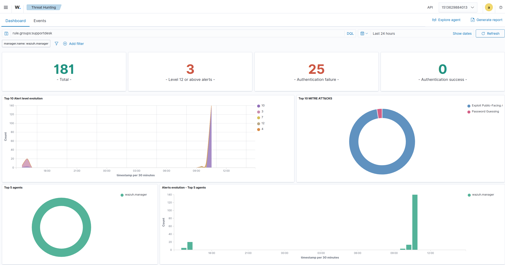
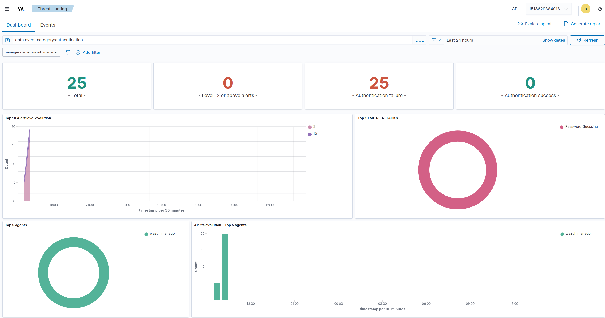

# Dashboard de détection Wazuh

Ce document décrit le tableau de bord utilisé pour visualiser et trier les alertes de détection de SupportDesk.

- **Outil :** Wazuh 4.14.9 - dashboard natif **Threat Hunting**
- **Accès :** `https://localhost` -> menu **Threat Hunting** -> onglet **Dashboard**
- **Identifiants par défaut :** `admin` / `SecretPassword`

---

## 1. Filtre de base

Toutes les vues sont restreintes aux alertes du projet grâce à la requête (barre de recherche DQL, en haut) :

```
rule.groups:supportdesk
```

Ce filtre exclut le bruit de fond (alertes système du manager Wazuh : intégrité de fichiers, évaluation de configuration, etc.) et ne conserve que les alertes produites par les règles custom `100100`-`100169`.

La requête est **sauvegardée** (icône disquette à gauche de la barre de recherche) pour être réappliquée en un clic.

---

## 2. Panneaux du dashboard

Le dashboard couvre les quatre dimensions demandées : **sévérité, timeline, type d'attaque, source.**

| Panneau                             | Dimension           | Ce qu'il montre                                                                                                             |
| ----------------------------------- | ------------------- | --------------------------------------------------------------------------------------------------------------------------- |
| **Compteurs (en-tête)**             | Volume              | Total d'alertes, alertes de niveau ≥ 12 (critiques), échecs et succès d'authentification                                    |
| **Top 10 Alert level evolution**    | Sévérité + timeline | Évolution du nombre d'alertes dans le temps, découpée par niveau de sévérité (3, 4, 7, 10, 12…)                             |
| **Top 10 MITRE ATT&CKS**            | Type d'attaque      | Répartition des techniques : _Exploit Public-Facing Application_ (SQLi, SSRF, traversal), _Password Guessing_ (brute force) |
| **Top 5 agents**                    | Source              | Répartition des alertes par agent émetteur                                                                                  |
| **Alerts evolution - Top 5 agents** | Source + timeline   | Évolution des alertes par source dans le temps                                                                              |



---

## 3. Filtrer par sévérité

La sévérité est lisible directement dans le panneau _Alert level evolution_ (légende par niveau). Pour isoler un niveau, ajouter à la requête :

```
rule.groups:supportdesk and rule.level >= 10
```

Rappel de l'échelle du projet :

| Niveau | Signification                                                |
| ------ | ------------------------------------------------------------ |
| 3-5    | Événement unitaire notable (un échec de login, un 404)       |
| 7-9    | Comportement suspect (tentative de traversal, payload isolé) |
| 10     | Attaque probable (brute force, injection, scan)              |
| 12+    | Attaque réussie (ex. traversal ayant lu un fichier)          |

---

## 4. Filtrer par type d'événement

Le type d'attaque est visible via le panneau MITRE. Pour filtrer sur un type d'événement applicatif précis, ajouter l'un de ces critères à la requête :

```
rule.groups:supportdesk and data.event.category:authentication
rule.groups:supportdesk and data.event.action:export
rule.groups:supportdesk and data.event.action:login
```

Le dashboard entier se recalcule sur le sous-ensemble filtré.



---

## 5. Filtrer par source

La source est visible via les panneaux _Top 5 agents_. Pour filtrer sur une IP d'attaquant précise :

```
rule.groups:supportdesk and data.source.ip:"203.0.113.42"
```

**Note sur l'IP source :** en test local, les attaques lancées par `curl`, `hydra` ou `sqlmap` sans en-tête `X-Forwarded-For` apparaissent avec l'IP du bridge Docker (`::ffff:172.18.0.1`). Pour distinguer plusieurs sources, l'en-tête `X-Forwarded-For` est utilisé (contrat §4.2) - ce qui constitue aussi le vecteur d'évasion documenté (rotation d'IP).

---

## 6. Vue tabulaire (onglet Events)

L'onglet **Events** complète le dashboard avec une table d'investigation. Colonnes configurées :

`timestamp` · `rule.description` · `rule.id` · `rule.level` · `data.source.ip` · `rule.mitre.technique`

Chaque ligne est dépliable (icône loupe à gauche) pour voir le détail complet d'une alerte, y compris le champ `previous_output` qui contient les événements ayant conduit à une corrélation (brute force, scan).

---

## 7. Usage pour le tri des alertes

Procédure rapide pour trier une vague d'alertes :

1. Appliquer le filtre de base `rule.groups:supportdesk`.
2. Restreindre la période (sélecteur en haut à droite) autour de l'incident.
3. Trier par sévérité décroissante (`rule.level >= 10`) pour traiter d'abord les attaques probables et réussies.
4. Pour chaque alerte, ouvrir le détail et relever : `rule.id`, `data.source.ip`, et le payload (`data.http.request.query` / `body`).
5. Classer en vrai ou faux positif (voir le rapport de qualification des alertes, étape 3).
