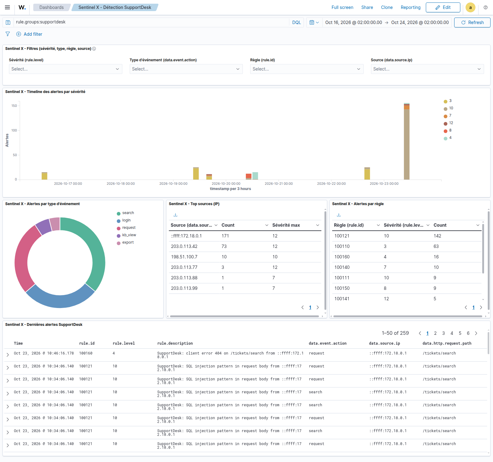

# Dashboard de détection Wazuh

Ce document décrit le tableau de bord utilisé pour visualiser et trier les alertes de détection de SupportDesk.

- **Outil :** Wazuh 4.14.9 - dashboard **versionné** « Sentinel X - Détection SupportDesk » (+ vue native **Threat Hunting** en complément)
- **Accès :** `https://localhost` -> menu ☰ -> **Explore** -> **Dashboards** -> **Sentinel X - Détection SupportDesk**, ou directement `https://localhost/app/dashboards#/view/sentinelx-detection`
- **Identifiants par défaut :** `admin` / `SecretPassword`
- **Source de vérité :** [`detection/wazuh/dashboards/sentinelx-saved-objects.ndjson`](../../detection/wazuh/dashboards/sentinelx-saved-objects.ndjson)

---

## 1. Installation (automatique et reproductible)

Le dashboard n'est pas configuré à la main dans l'interface : ses objets (requête sauvegardée, visualisations, recherche, dashboard) sont **exportés dans le dépôt** au format ndjson d'OpenSearch Dashboards.

- **Automatique :** le service one-shot `wazuh.dashboard-init` (dans `detection/wazuh/docker-compose.wazuh.yml`) attend que `wazuh.dashboard` soit `healthy`, importe le fichier, puis s'arrête (exit 0). Rien à faire après `docker compose up -d`.
- **Manuel** (après modification, ou sur une stack déjà démarrée) :

```bash
./detection/wazuh/dashboards/import-saved-objects.sh
# OK: 8 objects imported -> https://localhost/app/dashboards#/view/sentinelx-detection
```

L'import écrase uniquement les objets du projet (identifiants `supportdesk` et `sentinelx-*`). Si le pattern d'index `wazuh-alerts-*` n'existe pas encore (stack neuve, interface jamais ouverte), le script en crée un minimal (`timeFieldName: timestamp`).

**Modifier le dashboard :** l'éditer dans l'interface, puis le ré-exporter dans le dépôt (sinon la modification est perdue au prochain import) :

```bash
curl -sk -u admin:SecretPassword -H 'osd-xsrf: true' -H 'Content-Type: application/json' \
  https://localhost/api/saved_objects/_export \
  -d '{"objects":[{"type":"query","id":"supportdesk"},{"type":"visualization","id":"sentinelx-filters"},{"type":"visualization","id":"sentinelx-timeline-severity"},{"type":"visualization","id":"sentinelx-event-type"},{"type":"visualization","id":"sentinelx-top-sources"},{"type":"visualization","id":"sentinelx-by-rule"},{"type":"search","id":"sentinelx-alerts"},{"type":"dashboard","id":"sentinelx-detection"}],"excludeExportDetails":true}' \
  > detection/wazuh/dashboards/sentinelx-saved-objects.ndjson
```

---

## 2. Filtre de base

Le dashboard est enregistré avec la requête :

```
rule.groups:supportdesk
```

Ce filtre exclut le bruit de fond (alertes système du manager Wazuh : intégrité de fichiers, évaluation de configuration, etc.) et ne conserve que les alertes produites par les règles custom `100100`-`100169`. La même requête est versionnée comme **requête sauvegardée** `supportdesk` (icône disquette à gauche de la barre de recherche), réutilisable dans Discover ou Threat Hunting.

---

## 3. Panneaux du dashboard

Le dashboard couvre les quatre dimensions demandées : **sévérité, timeline, type d'événement, source.**

| Panneau                                       | Dimension                    | Ce qu'il montre                                                                                          |
| --------------------------------------------- | ---------------------------- | -------------------------------------------------------------------------------------------------------- |
| **Filtres (sévérité, type, règle, source)**   | Filtres                      | Quatre listes déroulantes : `rule.level`, `data.event.action`, `rule.id`, `data.source.ip`. Une sélection filtre tout le dashboard |
| **Timeline des alertes par sévérité**         | Timeline + sévérité          | Histogramme empilé dans le temps, une couleur par niveau (3, 4, 7, 8, 10, 12)                            |
| **Alertes par type d'événement**              | Type d'événement             | Répartition par `data.event.action` (`login`, `search`, `kb_view`, `export`, `request`)                  |
| **Top sources (IP)**                          | Source                       | Les 10 IP (`data.source.ip`) qui génèrent le plus d'alertes, avec leur sévérité maximale                 |
| **Alertes par règle**                         | Type d'attaque + sévérité    | Nombre d'alertes par `rule.id` et niveau                                                                 |
| **Dernières alertes SupportDesk**             | Investigation                | Table triée par date : `rule.id`, `rule.level`, `rule.description`, `data.event.action`, `data.source.ip`, `data.http.request.path` |

La **timeline** se règle avec le sélecteur de temps (en haut à droite) ; on peut aussi sélectionner une zone de l'histogramme à la souris pour zoomer sur un incident.



---

## 4. Filtrer par sévérité

Liste déroulante **Sévérité (rule.level)** du panneau de filtres, ou clic sur un niveau de la légende de la timeline. Équivalent en requête :

```
rule.groups:supportdesk and rule.level >= 10
```

Rappel de l'échelle du projet :

| Niveau | Signification                                                |
| ------ | ------------------------------------------------------------ |
| 3-5    | Événement unitaire notable (un échec de login, un 404)       |
| 7-9    | Comportement suspect (tentative de traversal, IDOR isolé)    |
| 10     | Attaque probable (brute force, injection, scan)              |
| 12+    | Attaque réussie (ex. traversal ayant lu un fichier)          |

---

## 5. Filtrer par type d'événement

Liste déroulante **Type d'événement (data.event.action)** ou **Règle (rule.id)**, ou clic sur une part du panneau *Alertes par type d'événement*. Équivalents en requête :

```
rule.groups:supportdesk and data.event.category:authentication
rule.groups:supportdesk and data.event.action:export
rule.groups:supportdesk and data.event.action:login
```

Le dashboard entier se recalcule sur le sous-ensemble filtré.

---

## 6. Filtrer par source

Liste déroulante **Source (data.source.ip)** ou clic sur une IP du panneau *Top sources (IP)*. Équivalent en requête :

```
rule.groups:supportdesk and data.source.ip:"203.0.113.42"
```

La source est l'IP **du client HTTP** (`data.source.ip`, contrat §4.2), pas l'agent Wazuh : tous les logs étant lus par le manager depuis le fichier partagé (D-008), l'agent émetteur est toujours `wazuh.manager` et ne permet pas de distinguer les attaquants.

**Note sur l'IP source :** en test local, les attaques lancées par `curl`, `hydra` ou `sqlmap` sans en-tête `X-Forwarded-For` apparaissent avec l'IP du bridge Docker (`::ffff:172.18.0.1`). Pour distinguer plusieurs sources, l'en-tête `X-Forwarded-For` est utilisé (contrat §4.2) - ce qui constitue aussi le vecteur d'évasion documenté (rotation d'IP).

---

## 7. Vue native Threat Hunting (complément)

Le module natif **Threat Hunting** de Wazuh reste utilisable avec la même requête `rule.groups:supportdesk` (requête sauvegardée `supportdesk`). Son onglet **Events** offre une table d'investigation où chaque ligne est dépliable (icône loupe) pour voir le détail complet d'une alerte, y compris le champ `previous_output` qui contient les événements ayant conduit à une corrélation (brute force, scan). Ses panneaux *Top 5 agents* ne montrent que l'agent `wazuh.manager` (voir §6) : la source se lit dans le dashboard Sentinel X.


---

## 8. Usage pour le tri des alertes

Procédure rapide pour trier une vague d'alertes :

1. Ouvrir le dashboard **Sentinel X - Détection SupportDesk** (filtre de base déjà appliqué).
2. Restreindre la période (sélecteur en haut à droite, ou sélection dans la timeline) autour de l'incident.
3. Filtrer **Sévérité** sur 10 et 12 pour traiter d'abord les attaques probables et réussies.
4. Pour chaque alerte (table du bas), relever : `rule.id`, `data.source.ip`, et le payload (`data.http.request.query` / `body`, dans le détail de l'alerte).
5. Classer en vrai ou faux positif (voir le [rapport de qualification des alertes](alert-qualification-report.md)).
