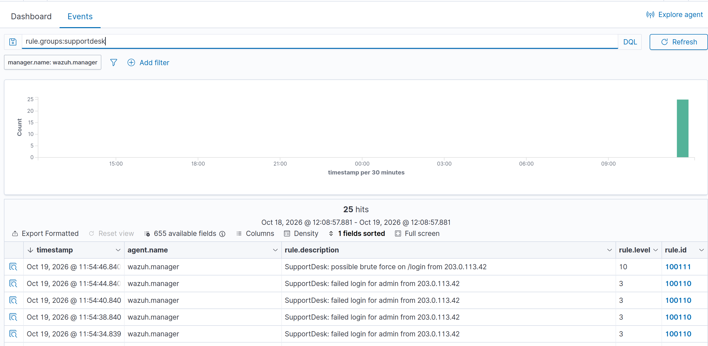

# T-004 - Chaîne de bout en bout : fichier de logs -> Wazuh -> dashboard

- **Date :** 19-10-2026
- **Auteur :** Meghan CRESCI-HUMANN
- **Version Wazuh :** 4.14.9 (single-node, `detection/wazuh/docker-compose.wazuh.yml`)
- **Contrat :** CONTRACT.md v0.2.0
- **Règles concernées :** 100100, 100110, 100111
- **Statut :** ✅ Validé après deux corrections du format de log

## Objectif

Vérifier la chaîne complète, au-delà de `wazuh-logtest` :

1. Wazuh lit le fichier de logs partagé `/var/log/sentinelx/app.jsonl` ;
2. les règles custom se déclenchent sur les événements lus ;
3. les alertes sont **indexées** et visibles dans le dashboard (Threat Hunting).

## Configuration testée

- Volume : `detection/logs/` monté en lecture seule dans `wazuh.manager` sur `/var/log/sentinelx`.
- Règles : `detection/rules/local_rules.xml` monté sur `/var/ossec/etc/rules/local_rules.xml`.
- Lecture du fichier (`config/wazuh_cluster/wazuh_manager.conf`) :
  ```xml
  <localfile>
    <log_format>json</log_format>
    <location>/var/log/sentinelx/app.jsonl</location>
  </localfile>
  ```

Vérification que le fichier est surveillé :

```bash
docker exec sentinelx-wazuh.manager-1 grep -i "sentinelx" /var/ossec/logs/ossec.log
# wazuh-logcollector: INFO: (1950): Analyzing file: '/var/log/sentinelx/app.jsonl'.
```

## Procédure

```bash
: > detection/logs/app.jsonl
for i in 1 2 3 4 5; do cat detection/samples/login_failure.jsonl >> detection/logs/app.jsonl; sleep 1; done
```

Puis, dans le dashboard : **Threat Hunting -> Events**, requête `rule.groups:supportdesk`, période « Last 24 hours ».

Diagnostic en cas d'absence d'alerte (dans cet ordre) :

```bash
# 1. Le conteneur voit-il les lignes ?
docker exec sentinelx-wazuh.manager-1 wc -l /var/log/sentinelx/app.jsonl
# 2. Les alertes sont-elles générées ?
docker exec sentinelx-wazuh.manager-1 grep -c "supportdesk" /var/ossec/logs/alerts/alerts.json
# 3. L'indexer les a-t-il refusées ?
docker logs --since 5m sentinelx-wazuh.manager-1 2>&1 | grep -iE "cannot index|mapper_parsing"
```

## Problèmes rencontrés et corrections

### Problème 1 — JSON indenté : aucune alerte

**Symptôme :** aucune alerte, aucune erreur. `wc -l` renvoie **110 lignes pour 5 événements**.

**Cause :** l'échantillon `login_failure.json` avait été reformaté (indenté) par l'éditeur. Wazuh lit le fichier ligne par ligne : chaque événement était découpé en 22 fragments JSON invalides, ignorés silencieusement.

**Correction :**

- échantillon remis sur une seule ligne et renommé `login_failure.jsonl` (l'éditeur ne le reformate plus) ;
- règle ajoutée au contrat (§4) : un objet JSON par ligne, jamais indenté.

### Problème 2 — Conflit de mapping `data.url` : alertes générées mais jamais indexées

**Symptôme :** `alerts.json` contient bien les 5 alertes, mais le dashboard n'affiche rien.

**Cause :** Filebeat (dans le manager) envoie les alertes à l'indexer, qui les refuse :

```
(status=400): {"type":"mapper_parsing_exception",
"reason":"failed to parse field [data.url] of type [keyword] in document with id '…'.
Preview of field's value: '{path=/login}'",
"caused_by":{"type":"illegal_state_exception","reason":"Can't get text on a START_OBJECT at 1:572"}}
```

Le template d'index Wazuh déclare `data.url` comme texte (`keyword`). Le format ECS du contrat y plaçait un objet (`url.path`), ce qui rend le document invalide.

**Correction :**

- `url.path` remplacé par `http.request.path` dans le contrat et dans l'échantillon ;
- règles ajoutées au contrat (§4) : aucun objet `url`, un seul type par champ ;
- décision **D-006** dans le decision log.

## Résultat final

| Critère                                   | Résultat                                                             |
| ----------------------------------------- | -------------------------------------------------------------------- |
| Fichier surveillé par le manager          | ✅                                                                   |
| 5 lignes dans le conteneur                | ✅                                                                   |
| 5 alertes dans `alerts.json`              | ✅                                                                   |
| Aucune erreur d'indexation                | ✅                                                                   |
| 5 alertes visibles dans le dashboard      | ✅                                                                   |
| Description, niveau et IP source corrects | ✅ `SupportDesk: failed login for admin from 203.0.113.42`, niveau 3 |


Capture réalisée après le rejeu automatique du 2026-10-19 (`detection/tests/run.sh`) : 25 alertes SupportDesk, dont les échecs unitaires 100110 (niveau 3) et l'alerte brute force 100111 (niveau 10), toutes indexées et visibles dans Threat Hunting.

> Remarque : la colonne `timestamp` du dashboard est l'heure de **réception** par Wazuh, pas le `@timestamp` du log. À prendre en compte pour la mesure du temps de détection.

## Conclusion

La chaîne fichier -> Wazuh -> règles -> indexer -> dashboard est fonctionnelle. Ce test a révélé deux incompatibilités **silencieuses** du format de log (aucune erreur visible côté application ni dans `wazuh-logtest`) qui auraient empêché toute détection lors de la démo. Elles sont corrigées dans le contrat v0.2.0.

**Leçon :** `wazuh-logtest` valide le décodage et les règles, mais **pas l'indexation**. Toute modification du schéma de log doit être validée jusqu'au dashboard.

Le comportement de la règle de corrélation 100111 dans cette chaîne est traité dans T-005.
