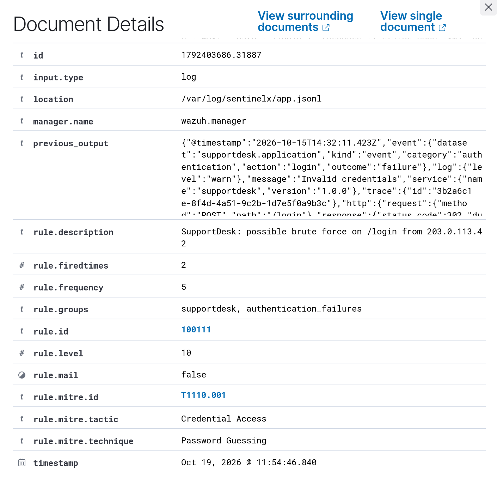

# T-005 - Corrélation brute force : événements en rafale vs espacés

- **Date :** 19-10-2026
- **Auteur :** Meghan CRESCI-HUMANN
- **Version Wazuh :** 4.14.9 (single-node)
- **Contrat :** CONTRACT.md v0.2.0
- **Règles concernées :** 100110, 100111 (`frequency="5"`, `timeframe="60"`, `same_field source.ip`)
- **MITRE ATT&CK :** T1110.001 - Password Guessing
- **Statut :** ⚠️ Fonctionnel, limite identifiée

## Contexte

Dans `wazuh-logtest` (T-003), la règle 100111 se déclenche au 5ᵉ échec. Lors de T-004, les 5 échecs injectés dans le fichier n'ont produit **aucune** alerte 100111. Ce test cherche à comprendre pourquoi.

## Procédure

**Cas A - rafale :** 5 lignes écrites d'un coup.

```bash
: > detection/logs/app.jsonl
for i in 1 2 3 4 5; do cat detection/samples/login_failure.jsonl >> detection/logs/app.jsonl; done
```

**Cas B - espacé :** 10 lignes, 3 secondes d'écart (30 s au total, sous la fenêtre de 60 s).

```bash
for i in $(seq 1 10); do cat detection/samples/login_failure.jsonl >> detection/logs/app.jsonl; sleep 3; done
```

**Mesure :**

```bash
docker exec sentinelx-wazuh.manager-1 grep -c '"id":"100111"' /var/ossec/logs/alerts/alerts.json
```

## Résultats

| Cas                                     | Échecs envoyés | Alertes 100111 attendues | Alertes 100111 obtenues |
| --------------------------------------- | -------------- | ------------------------ | ----------------------- |
| A - rafale (et variante avec `sleep 1`) | 5              | 1                        | **0**                   |
| B - espacé de 3 s                       | 10             | 2                        | **2** ✅                |

Observations complémentaires :

- Avec `sleep 1`, les lignes ont quand même été lues par paquets (3 événements à 13:53:24, 2 à 13:53:26) : le manager lit le fichier environ toutes les 2 secondes.
- Lors du premier essai en rafale, les alertes 100110 sont sorties **dans le désordre** (`firedtimes` 3, 5, 4, 2, 1).
- Les 100110 unitaires sont toutes générées dans les deux cas : seule la corrélation est affectée.

### Alerte 100111 dans le dashboard



On y retrouve le niveau 10, l'IP source dans la description, le mapping MITRE ajouté automatiquement par Wazuh, et le champ `previous_output` qui contient les échecs ayant déclenché la corrélation.

## Analyse

Quand plusieurs événements arrivent dans la même lecture, la corrélation `frequency` ne les compte pas correctement. Le désordre des `firedtimes` suggère que le manager traite les événements d'un même paquet en parallèle. **Hypothèse non confirmée** à ce stade : elle explique les résultats, mais le mécanisme interne n'a pas été vérifié dans la documentation Wazuh.

**Conséquence opérationnelle :** un vrai brute force (hydra, ffuf) envoie de nombreuses requêtes par seconde, donc exactement le cas défavorable. Risques :

- détection retardée (l'alerte arrive plus tard que le 5ᵉ échec) ;
- volume d'attaque sous-estimé (moins d'alertes 100111 que prévu) ;
- dans le pire cas, attaque courte non détectée.

## Actions de suivi

- [ ] Rejouer pendant l'attaque réelle (étape 2) : mesurer le nombre d'échecs avant la 1ʳᵉ alerte 100111 et le délai de détection.
- [ ] Tester une rafale plus longue (50, 100 échecs) pour voir si la corrélation finit par se déclencher et à quel rythme.
- [ ] Rechercher dans la documentation Wazuh le traitement parallèle des événements et les options associées.
- [ ] Selon les résultats : ajuster le seuil ou ajouter une règle complémentaire (par exemple sur le volume d'échecs), et documenter le choix dans l'attack plan brute force.
