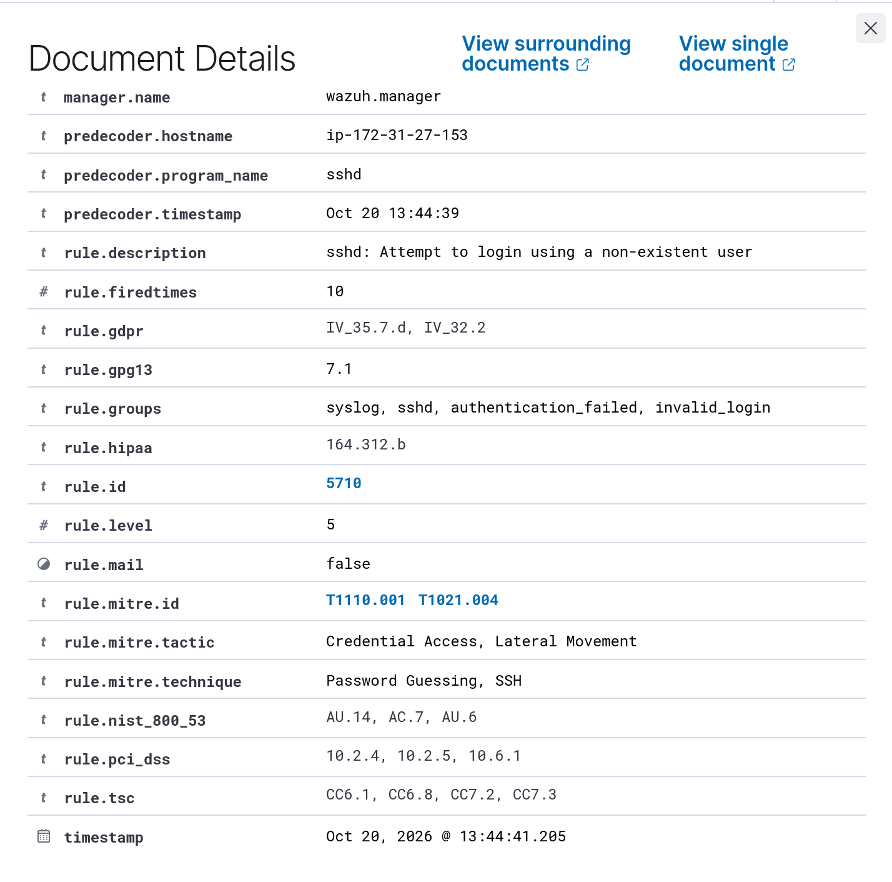
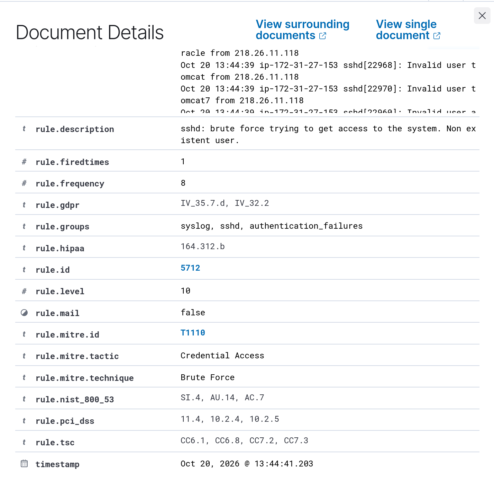

# T-012 - Règles natives de Wazuh sur les logs d'entraînement

- **Date :** 20-10-2026
- **Auteur :** Meghan CRESCI-HUMANN
- **Version Wazuh :** 4.14.9 (single-node)
- **Objectif sujet :** injecter des logs d'entraînement, explorer l'interface, **identifier les règles natives**
- **Statut :** ✅ Règles natives 5710 et 5712 identifiées et déclenchées

## Objectif

Le sujet demande, avant d'écrire des règles custom, d'injecter des logs d'entraînement et de repérer les règles **déjà fournies** par Wazuh. Ce test utilise un jeu de logs d'authentification SSH réel et documente les règles natives qui se déclenchent sans aucune règle écrite par l'équipe.

## Jeu de données

- **Source :** [secrepo.com](https://www.secrepo.com/) - `auth.log` (journal d'authentification Linux réel).
- **Volume :** 86 839 lignes. Fichier non versionné (`detection/samples/training/` est dans `.gitignore`).
- **Format :** syslog standard, par exemple :
  ```
  Nov 30 08:42:04 ip-172-31-27-153 sshd[22182]: Invalid user admin from 187.12.249.74
  ```

## Configuration

Second bloc `<localfile>` ajouté dans `wazuh_manager.conf`, à côté de celui de l'application :

```xml
<localfile>
  <log_format>syslog</log_format>
  <location>/var/log/sentinelx/training.log</location>
</localfile>
```

Injection d'un lot avec réécriture de l'horodatage à l'heure courante (voir piège n°1) :

```bash
grep -iE "Invalid user|Failed password|authentication failure" detection/samples/training/auth.log | head -n 200 | \
  sed "s/^[A-Z][a-z]\{2\} [0-9 ][0-9] [0-9:]\{8\}/$(date '+%b %e %H:%M:%S')/" >> detection/logs/training.log
```

## Règles natives identifiées

```bash
docker exec sentinelx-wazuh.manager-1 grep -oE '"id":"5[0-9]{3}"' /var/ossec/logs/alerts/alerts.json | sort | uniq -c | sort -rn
# 100 "id":"5710"
#   1 "id":"5712"
```

| Règle    | Niveau | Description                                          | Rôle                                                                             | MITRE                |
| -------- | ------ | ---------------------------------------------------- | -------------------------------------------------------------------------------- | -------------------- |
| **5710** | 5      | sshd: Attempt to login using a non-existent user     | Événement unitaire : une tentative avec un utilisateur inexistant                | T1110.001, T1021.004 |
| **5712** | 10     | sshd: brute force trying to get access to the system | **Corrélation** : plusieurs échecs rapprochés depuis la même IP (`frequency: 8`) | T1110                |

Ces règles enrichissent automatiquement chaque alerte avec les référentiels de conformité (PCI-DSS, GDPR, HIPAA, NIST 800-53, TSC) et le mapping MITRE ATT&CK.





L'alerte 5712 montre, dans son contexte, la suite de tentatives depuis une même IP (`218.26.11.118`) avec des utilisateurs différents (`oracle`, `tomcat`, `tomcat7`…) : une énumération d'utilisateurs SSH.

## Rapprochement avec les règles custom

La structure native 5710 → 5712 est exactement celle reproduite pour SupportDesk :

| Pattern             | Règle native (SSH) | Règle custom (SupportDesk web) |
| ------------------- | ------------------ | ------------------------------ |
| Échec unitaire      | 5710 (niveau 5)    | 100110 (niveau 3)              |
| Brute force corrélé | 5712 (niveau 10)   | 100111 (niveau 10)             |

**Justification des règles custom :** Wazuh couvre nativement SSH, mais **aucune règle native ne connaît les logs applicatifs de SupportDesk** (format JSON propre au projet, endpoints web). Les règles 100110-100161 comblent ce vide, en suivant la même logique événement/corrélation que les règles éprouvées de Wazuh.

## Pièges rencontrés

1. **Horodatage sans année.** Les logs d'origine datent de `Nov 30` (pas d'année). Wazuh les situe hors de sa fenêtre de traitement temps réel : décodage correct dans `wazuh-logtest`, mais aucune alerte en direct. Solution : réécrire l'horodatage à l'heure courante avec `sed` avant injection.
2. **Modification de `wazuh_manager.conf` non prise en compte par `docker restart`.** Le fichier est monté individuellement ; un simple redémarrage garde l'ancienne version. Il faut recréer le conteneur :
   ```bash
   docker compose -f detection/wazuh/docker-compose.wazuh.yml up -d --force-recreate wazuh.manager
   ```
3. **Fichier vide non analysé.** Wazuh n'ouvre un `<localfile>` qu'une fois qu'il contient des données.

## Conclusion

Wazuh détecte immédiatement les attaques SSH de brute force grâce à ses règles natives (5710, 5712), sans configuration de détection supplémentaire. Cela valide la chaîne de lecture syslog et confirme le rôle des règles custom du projet : étendre cette couverture à l'application web SupportDesk, qu'aucune règle native ne traite.

## Actions de suivi

- [ ] Ajouter le piège n°2 (recréation du conteneur) au tableau des problèmes connus de `setup.md`.
- [ ] Optionnel : injecter les logs d'attaques web / scan (access-log Apache) pour repérer les règles natives de la famille 31xxx (web).
