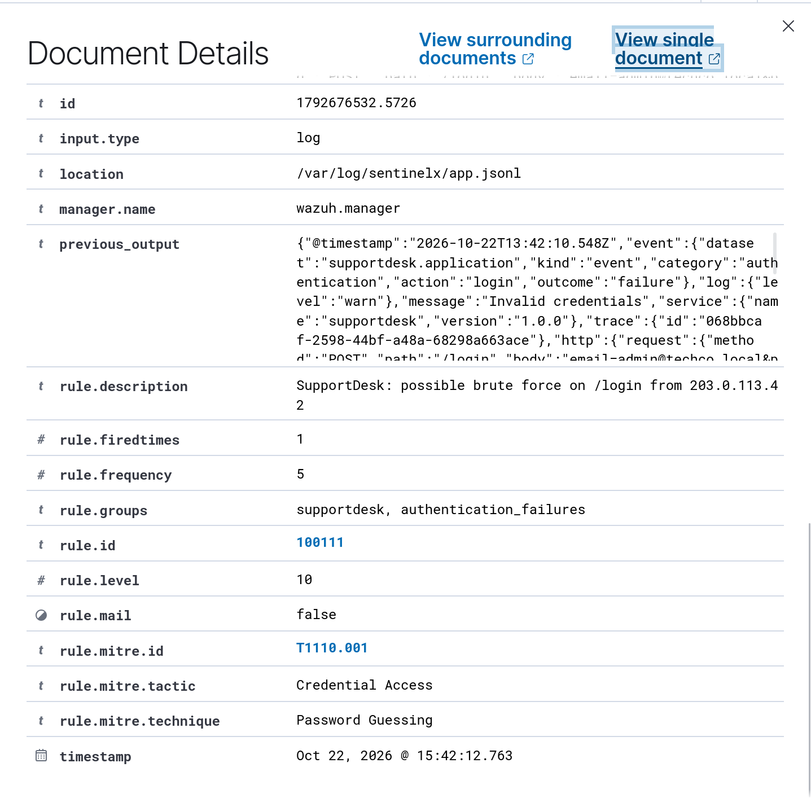

# T-013 - Dry-run : chaîne complète sur l'application réelle

- **Date :** 22-10-2026
- **Auteur :** Meghan CRESCI-HUMANN
- **Version Wazuh :** 4.14.9 (single-node)
- **Application :** SupportDesk V1 (conteneur `sentinelx-supportdesk-1`)
- **Contrat :** CONTRACT.md v0.3.0
- **Règles concernées :** 100100, 100110, 100111
- **Statut :** ✅ Dry-run réussi - l'étape 2 (attaques réelles) peut commencer

## Objectif

Jusqu'ici, toutes les règles étaient validées sur des **échantillons** de logs. Ce test valide la chaîne de bout en bout sur l'**application réellement instrumentée** : une vraie attaque HTTP produit un log applicatif, lu par Wazuh, qui génère une alerte visible dans le dashboard.

C'est le dry-run demandé à l'étape 2. Questions auxquelles il répond :

- Un log émis par l'application est-il reçu par Wazuh ?
- L'`event.outcome` attendu est-il visible dans les champs ?
- Une règle custom se déclenche-t-elle sur un événement réel ?
- L'alerte apparaît-elle dans le dashboard, avec la bonne sévérité et la bonne source ?
- Un autre membre peut-il reproduire ce résultat ?

## Pré-requis et corrections

Deux bugs de l'application ont dû être corrigés pour permettre le lancement :

1. **Dockerfile** : l'image `node:20-alpine` forçait la recompilation de `better-sqlite3` avec un téléchargement qui échouait (`ETIMEDOUT`). Corrigé en passant à `node:20-slim` (binaire pré-compilé disponible).
2. **`app.js`** : le gestionnaire d'erreurs appelait `logger.emitError(...)` alors que `emitError` est exporté séparément. Corrigé en important et appelant `emitError` directement.

Ces deux corrections ont été transmises à l'équipe web.

## Architecture du dry-run

```
curl (attaque) -> SupportDesk (:3000) -> écrit detection/logs/app.jsonl
                                      -> Wazuh manager lit le fichier
                                      -> règles 100110 / 100111
                                      -> alerte indexée -> dashboard
```

Le fichier de logs est le volume partagé `detection/logs/`, monté en écriture dans l'app et en lecture seule dans `wazuh.manager` (D-008).

## Procédure

**1. Démarrer l'application** (Wazuh tourne déjà) :

```bash
cd supportdesk
docker compose up -d --build
cd ..
```

→
→
→
→
→
→
→
→
→
→
**2. Vérifier que l'app répond et journalise** :

```bash
curl -s -o /dev/null -w "HTTP %{http_code}\n" http://localhost:3000/login
tail -n 1 detection/logs/app.jsonl
```

La requête renvoie HTTP 200 et produit une ligne de log conforme au contrat.

**3. Attaque : 5 échecs de connexion réels**, avec une IP simulée via `X-Forwarded-For` (contrat §4.2) :

```bash
for i in 1 2 3 4 5; do
  curl -s -o /dev/null -X POST http://localhost:3000/login \
    -d 'email=admin@techco.local&password=wrongpass' \
    -H 'X-Forwarded-For: 203.0.113.42'
  sleep 2
done
sleep 20
```

**4. Vérifier les alertes** :

```bash
docker exec sentinelx-wazuh.manager-1 grep -c '"id":"100110"' /var/ossec/logs/alerts/alerts.json
docker exec sentinelx-wazuh.manager-1 grep -c '"id":"100111"' /var/ossec/logs/alerts/alerts.json
```

## Résultats

Log réel produit par l'application (échec de connexion) :

```json
{
  "event": {
    "category": "authentication",
    "action": "login",
    "outcome": "failure"
  },
  "message": "Invalid credentials",
  "http": {
    "request": {
      "method": "POST",
      "path": "/login",
      "body": "email=admin@techco.local&password=***"
    },
    "response": { "status_code": 302 }
  },
  "source": { "ip": "203.0.113.42" },
  "user": { "name": "admin@techco.local" }
}
```

| Vérification                       | Attendu                    | Obtenu                                  |
| ---------------------------------- | -------------------------- | --------------------------------------- |
| Application répond                 | HTTP 200                   | ✅                                      |
| Échec de login signalé             | `event.outcome = failure`  | ✅ (route login appelle bien `stage()`) |
| Mot de passe masqué                | `password=***`             | ✅                                      |
| IP cliente simulée prise en compte | `source.ip = 203.0.113.42` | ✅ (via `X-Forwarded-For`)              |
| Alertes 100110 (échec unitaire)    | ≥ 1                        | ✅ 4                                    |
| Alerte 100111 (brute force)        | ≥ 1                        | ✅ 1                                    |
| Alerte visible dans le dashboard   | oui, niveau 10, bonne IP   | ✅                                      |



## Points remarquables

- **`source.ip` sans `X-Forwarded-For` renvoie l'IP du bridge Docker** (`::ffff:172.18.0.1`), exactement le cas anticipé au §4.2 du contrat. L'en-tête `X-Forwarded-For` permet de simuler des attaquants distincts, et constitue aussi le vecteur d'évasion documenté (rotation d'IP).
- Le format produit par le logger est **identique aux échantillons** utilisés pour développer les règles : aucune adaptation n'a été nécessaire côté détection. La validation du format _avant_ implémentation (T-006) a porté ses fruits.

## Conclusion

La chaîne complète fonctionne sur l'application réelle : attaque HTTP -> log applicatif -> Wazuh -> règle -> alerte indexée et visible. Le dry-run est réussi, l'étape 2 (exécution des attack plans réels) peut commencer.

## Reproductibilité

Un autre membre reproduit ce test en : démarrant Wazuh puis l'app (`docker compose up -d --build`), puis en lançant la boucle d'attaque ci-dessus. Les commandes sont auto-contenues et ne dépendent d'aucun état préalable.

## Actions de suivi

- [ ] Exécuter les attack plans AP-01/02/03 avec les vrais outils (hydra, sqlmap, ffuf) et remplir les runbooks.
- [ ] Vérifier le comportement en rafale (T-005) avec un vrai hydra rapide.
- [ ] Intégrer les corrections Dockerfile + `app.js` dans la branche de l'équipe.
