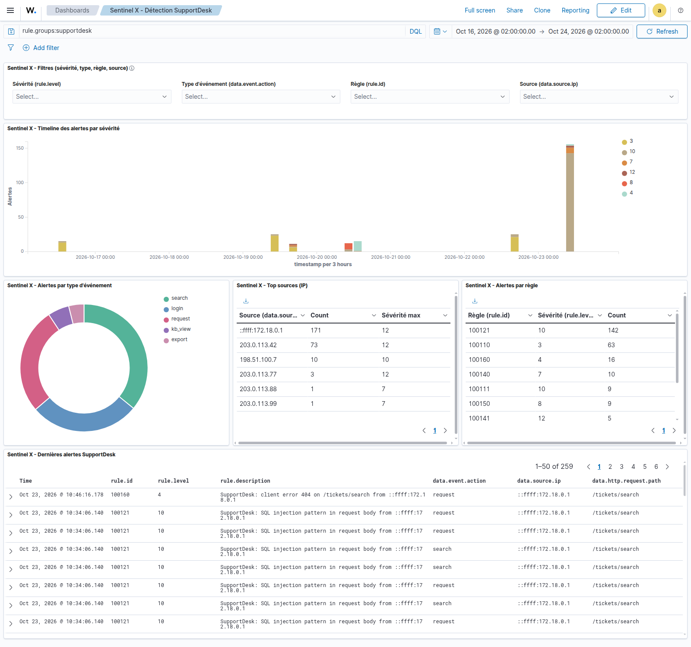
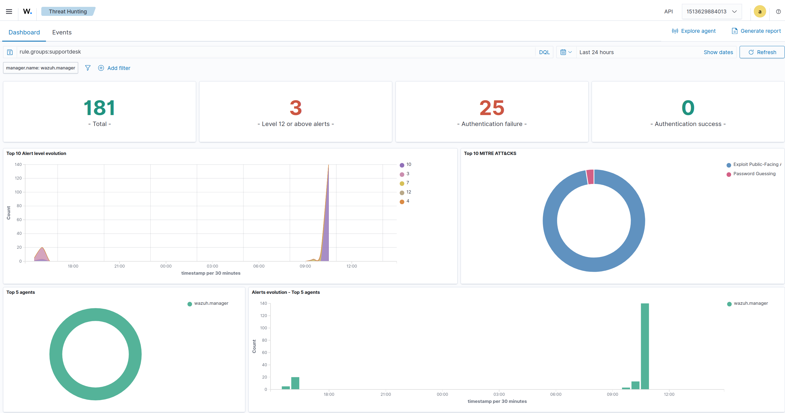
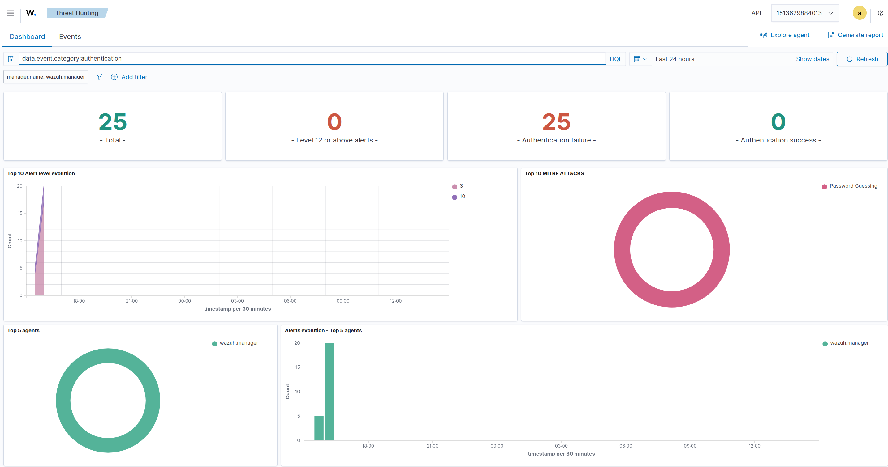

# Wazuh detection dashboard

This document describes the dashboard used to visualize and triage the SupportDesk detection alerts.

- **Tool:** Wazuh 4.14.9 - **versioned** dashboard "Sentinel X - Détection SupportDesk" (+ native **Threat Hunting** view as a complement)
- **Access:** `https://localhost` -> ☰ menu -> **Explore** -> **Dashboards** -> **Sentinel X - Détection SupportDesk**, or directly `https://localhost/app/dashboards#/view/sentinelx-detection`
- **Default credentials:** `admin` / `SecretPassword`
- **Source of truth:** [`detection/wazuh/dashboards/sentinelx-saved-objects.ndjson`](../../../detection/wazuh/dashboards/sentinelx-saved-objects.ndjson)

---

## 1. Installation (automatic and reproducible)

The dashboard is not configured by hand in the UI: its objects (saved query, visualizations, saved search, dashboard) are **exported into the repository** in the OpenSearch Dashboards ndjson format.

- **Automatic:** the one-shot `wazuh.dashboard-init` service (in `detection/wazuh/docker-compose.wazuh.yml`) waits for `wazuh.dashboard` to be `healthy`, imports the file, then stops (exit 0). Nothing to do after `docker compose up -d`.
- **Manual** (after a change, or on an already running stack):

```bash
./detection/wazuh/dashboards/import-saved-objects.sh
# OK: 8 objects imported -> https://localhost/app/dashboards#/view/sentinelx-detection
```

The import only overwrites the project objects (ids `supportdesk` and `sentinelx-*`). If the `wazuh-alerts-*` index pattern does not exist yet (fresh stack, UI never opened), the script creates a minimal one (`timeFieldName: timestamp`).

**Changing the dashboard:** edit it in the UI, then export it back into the repository (otherwise the change is lost at the next import):

```bash
curl -sk -u admin:SecretPassword -H 'osd-xsrf: true' -H 'Content-Type: application/json' \
  https://localhost/api/saved_objects/_export \
  -d '{"objects":[{"type":"query","id":"supportdesk"},{"type":"visualization","id":"sentinelx-filters"},{"type":"visualization","id":"sentinelx-timeline-severity"},{"type":"visualization","id":"sentinelx-event-type"},{"type":"visualization","id":"sentinelx-top-sources"},{"type":"visualization","id":"sentinelx-by-rule"},{"type":"search","id":"sentinelx-alerts"},{"type":"dashboard","id":"sentinelx-detection"}],"excludeExportDetails":true}' \
  > detection/wazuh/dashboards/sentinelx-saved-objects.ndjson
```

---

## 2. Base filter

The dashboard is saved with the query:

```
rule.groups:supportdesk
```

This filter excludes background noise (system alerts from the Wazuh manager: file integrity, configuration assessment, etc.) and keeps only the alerts produced by custom rules `100100`-`100169`. The same query is versioned as the **saved query** `supportdesk` (disk icon to the left of the search bar), reusable in Discover or Threat Hunting.

---

## 3. Dashboard panels

The dashboard covers the four requested dimensions: **severity, timeline, event type, source.**

| Panel                                         | Dimension                 | What it shows                                                                                             |
| --------------------------------------------- | ------------------------- | --------------------------------------------------------------------------------------------------------- |
| **Filtres (sévérité, type, règle, source)**   | Filters                   | Four drop-down lists: `rule.level`, `data.event.action`, `rule.id`, `data.source.ip`. A selection filters the whole dashboard |
| **Timeline des alertes par sévérité**         | Timeline + severity       | Stacked histogram over time, one color per level (3, 4, 7, 8, 10, 12)                                     |
| **Alertes par type d'événement**              | Event type                | Breakdown by `data.event.action` (`login`, `search`, `kb_view`, `export`, `request`)                      |
| **Top sources (IP)**                          | Source                    | The 10 IPs (`data.source.ip`) raising the most alerts, with their maximum severity                       |
| **Alertes par règle**                         | Attack type + severity    | Alert count per `rule.id` and level                                                                       |
| **Dernières alertes SupportDesk**             | Investigation             | Table sorted by date: `rule.id`, `rule.level`, `rule.description`, `data.event.action`, `data.source.ip`, `data.http.request.path` |

The **timeline** is set with the time picker (top right); you can also drag-select an area of the histogram to zoom on an incident.



---

## 4. Filter by severity

**Sévérité (rule.level)** drop-down of the filter panel, or click a level in the timeline legend. Query equivalent:

```
rule.groups:supportdesk and rule.level >= 10
```

Reminder of the project scale:

| Level | Meaning                                                   |
| ----- | ---------------------------------------------------------- |
| 3-5   | Notable single event (a failed login, a 404)               |
| 7-9   | Suspicious behavior (traversal attempt, isolated IDOR)     |
| 10    | Probable attack (brute force, injection, scan)             |
| 12+   | Successful attack (e.g. a traversal that read a file)      |

---

## 5. Filter by event type

**Type d'événement (data.event.action)** or **Règle (rule.id)** drop-down, or click a slice of the *Alertes par type d'événement* panel. Query equivalents:

```
rule.groups:supportdesk and data.event.category:authentication
rule.groups:supportdesk and data.event.action:export
rule.groups:supportdesk and data.event.action:login
```

The whole dashboard is recomputed on the filtered subset.

---

## 6. Filter by source

**Source (data.source.ip)** drop-down, or click an IP in the *Top sources (IP)* panel. Query equivalent:

```
rule.groups:supportdesk and data.source.ip:"203.0.113.42"
```

The source is the **HTTP client** IP (`data.source.ip`, contract §4.2), not the Wazuh agent: every log is read by the manager from the shared file (D-008), so the emitting agent is always `wazuh.manager` and cannot tell attackers apart.

**Note on the source IP:** in local testing, attacks launched by `curl`, `hydra` or `sqlmap` without an `X-Forwarded-For` header appear with the Docker bridge IP (`::ffff:172.18.0.1`). To distinguish multiple sources, the `X-Forwarded-For` header is used (contract §4.2) - which is also the documented evasion vector (IP rotation).

---

## 7. Native Threat Hunting view (complement)

Wazuh's native **Threat Hunting** module remains usable with the same `rule.groups:supportdesk` query (saved query `supportdesk`). Its **Events** tab offers an investigation table where each row is expandable (magnifier icon) to see the full detail of an alert, including the `previous_output` field, which contains the events that led to a correlation (brute force, scan). Its *Top 5 agents* panels only show the `wazuh.manager` agent (see §6): read the source in the Sentinel X dashboard.





---

## 8. Usage for alert triage

Quick procedure to triage a wave of alerts:

1. Open the **Sentinel X - Détection SupportDesk** dashboard (base filter already applied).
2. Restrict the time range (time picker at the top right, or a selection in the timeline) around the incident.
3. Filter **Sévérité** on 10 and 12 to handle probable and successful attacks first.
4. For each alert (bottom table), record: `rule.id`, `data.source.ip`, and the payload (`data.http.request.query` / `body`, in the alert detail).
5. Classify as true or false positive (see the [alert qualification report](alert-qualification-report.md)).
