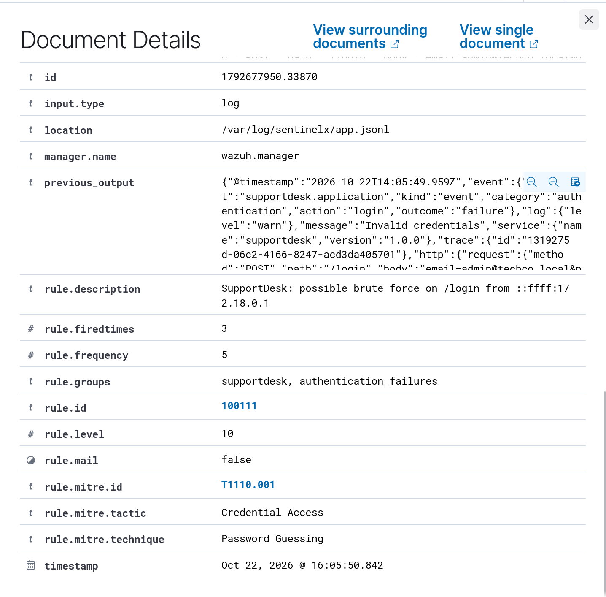

# Runbook RB-01 - Brute force on /login

- **Scenario:** brute force attack on authentication
- **Reference attack plan:** `detection/attack-plans/AP-01-bruteforce.md`
- **Detection rules:** 100110 (individual failure), 100111 (brute force correlation)
- **Execution date:** 22-10-2026
- **Operator:** Meghan CRESCI-HUMANN
- **Target:** SupportDesk V1 - `http://127.0.0.1:3000/login`
- **MITRE ATT&CK:** T1110.001 - Password Guessing

> A runbook is reproducible: by following the commands below, any team member
> can replay the attack and obtain the same alerts.

---

## 1. Prerequisites

- Wazuh and SupportDesk running:
  ```bash
  docker ps | grep -E "supportdesk|wazuh.manager"
  ```
- hydra installed (`hydra -h`).
- Test password list:
  ```bash
  cat > /tmp/passwords.txt << 'LIST'
  123456
  password
  admin
  letmein
  qwerty
  root
  toor
  admin123
  password1
  welcome
  LIST
  ```

## 2. Measurement (before/after)

The `alerts.json` file accumulates alerts: count before and after, then take the difference.

```bash
# BEFORE
docker exec sentinelx-wazuh.manager-1 grep -c '"id":"100111"' /var/ossec/logs/alerts/alerts.json
```

## 3. Attack commands

**Variant A - parallel (burst, 10 simultaneous tasks):**

```bash
hydra -l admin@techco.local -P /tmp/passwords.txt \
  -s 3000 127.0.0.1 http-post-form \
  "/login:email=^USER^&password=^PASS^:Invalid credentials" \
  -V
```

**Variant B - sequential (one attempt at a time):**

```bash
hydra -l admin@techco.local -P /tmp/passwords.txt \
  -s 3000 127.0.0.1 http-post-form \
  "/login:email=^USER^&password=^PASS^:Invalid credentials" \
  -t 1 -V
```

Format explanation: `^USER^` / `^PASS^` are replaced by hydra; `Invalid credentials` is the string that marks a failure (it lets hydra know an attempt failed).

## 4. After measurement and verification

```bash
sleep 20
docker exec sentinelx-wazuh.manager-1 grep -c '"id":"100110"' /var/ossec/logs/alerts/alerts.json
docker exec sentinelx-wazuh.manager-1 grep -c '"id":"100111"' /var/ossec/logs/alerts/alerts.json
```

Dashboard: Threat Hunting -> Events -> `rule.id:100111`.

---

## 5. Observations (2026-10-22 execution)

### Execution

| Variant                   | Duration of the 10 attempts | 100111 alerts (before -> after) | Delta  |
| ------------------------- | --------------------------- | ------------------------------- | ------ |
| A - parallel (10 tasks)   | ~1 s (16:04:16 -> 16:04:17) | 1 -> 3                          | **+2** |
| B - sequential (`-t 1`)   | ~3 s (16:05:49 -> 16:05:52) | 3 -> 4                          | **+1** |

- The 10 attempts generated **100110** alerts (individual failure, level 3) for each try, then **100111** alerts (brute force, level 10) in correlation steps.
- hydra found no valid password (`0 valid password found`): the attack fails functionally, but **is properly detected**.
- Since hydra sends no `X-Forwarded-For`, all requests carry the Docker bridge IP: from a correlation standpoint they come from the same source (which here **helps** detection), but the attacker's real IP does not appear.

### Alert obtained (100111)

- Rule: 100111, level 10
- Description: "possible brute force on /login"
- Groups: `supportdesk, authentication_failures`
- MITRE: T1110.001 (Credential Access / Password Guessing)



---

## 6. Analysis

- **Detection success:** the attack is detected in both modes. The AP-01 success criterion (severity ≥ 10 alert, rule 100111) is **met**.
- **Effect of pacing on correlation:** the parallel mode produced more alerts (+2) than the sequential one (+1), even though it is faster. The `frequency=5 / timeframe=60` correlation fires at several steps depending on how the requests group when read. This ties into the limitation studied in **T-005**: counting depends on the pace at which events arrive, not only on their number.
- **Detection not slowed down:** unlike the T-005 micro-burst (5 simultaneous events -> 0 alerts), a realistic hydra (10 attempts over 1 to 3 s) is correctly detected.

## 7. Limitations and next steps

- **Evasion through slowness:** an attacker sending fewer than 5 attempts per minute stays under the 100111 threshold (each failure still triggers 100110). -> bonus evasion scenario: slow brute force.
- **Evasion through IP rotation:** with a real reverse proxy and a rotating `X-Forwarded-For`, the `same_field source.ip` correlation would be bypassed. -> documented as an evasion vector (contract §4.2).
- **Threshold to validate:** the 5/60 s threshold must be confirmed against the normal-traffic script (step 3) to avoid false positives on typos from legitimate users.

## 8. Status

| Criterion (AP-01)                                    | Result                   |
| ---------------------------------------------------- | ------------------------ |
| Severity ≥ 10 alert, rule 100111                     | ✅                       |
| Detection < 2 min                                    | ✅ (a few seconds)       |
| Attack functionally blocked (no password found)      | ✅                       |
| Reproducible                                         | ✅ (commands above)      |

**Conclusion: scenario validated.** The brute force detection rule works against a real attack tool (hydra).