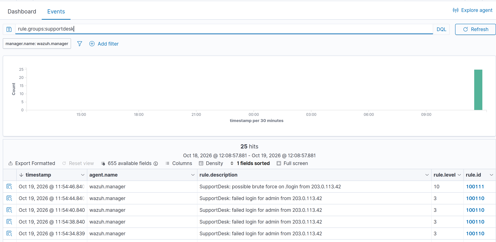

# T-004 - End-to-end chain: log file -> Wazuh -> dashboard

- **Date:** 19-10-2026
- **Author:** Meghan CRESCI-HUMANN
- **Wazuh version:** 4.14.9 (single-node, `detection/wazuh/docker-compose.wazuh.yml`)
- **Contract:** CONTRACT.md v0.2.0
- **Rules involved:** 100100, 100110, 100111
- **Status:** ✅ Validated after two log format fixes

## Objective

Verify the complete chain, beyond `wazuh-logtest`:

1. Wazuh reads the shared log file `/var/log/sentinelx/app.jsonl`;
2. the custom rules fire on the events read;
3. alerts are **indexed** and visible in the dashboard (Threat Hunting).

## Tested configuration

- Volume: `detection/logs/` mounted read-only into `wazuh.manager` at `/var/log/sentinelx`.
- Rules: `detection/rules/local_rules.xml` mounted at `/var/ossec/etc/rules/local_rules.xml`.
- File reading (`config/wazuh_cluster/wazuh_manager.conf`):
  ```xml
  <localfile>
    <log_format>json</log_format>
    <location>/var/log/sentinelx/app.jsonl</location>
  </localfile>
  ```

Verify the file is monitored:

```bash
docker exec sentinelx-wazuh.manager-1 grep -i "sentinelx" /var/ossec/logs/ossec.log
# wazuh-logcollector: INFO: (1950): Analyzing file: '/var/log/sentinelx/app.jsonl'.
```

## Procedure

```bash
: > detection/logs/app.jsonl
for i in 1 2 3 4 5; do cat detection/samples/login_failure.jsonl >> detection/logs/app.jsonl; sleep 1; done
```

Then, in the dashboard: **Threat Hunting -> Events**, query `rule.groups:supportdesk`, period "Last 24 hours".

Diagnostic when no alert appears (in this order):

```bash
# 1. Does the container see the lines?
docker exec sentinelx-wazuh.manager-1 wc -l /var/log/sentinelx/app.jsonl
# 2. Are the alerts generated?
docker exec sentinelx-wazuh.manager-1 grep -c "supportdesk" /var/ossec/logs/alerts/alerts.json
# 3. Did the indexer reject them?
docker logs --since 5m sentinelx-wazuh.manager-1 2>&1 | grep -iE "cannot index|mapper_parsing"
```

## Issues encountered and fixes

### Issue 1 — Indented JSON: no alerts

**Symptom:** no alert, no error. `wc -l` returns **110 lines for 5 events**.

**Cause:** the `login_failure.json` sample had been reformatted (indented) by the editor. Wazuh reads the file line by line: each event was split into 22 invalid JSON fragments, silently ignored.

**Fix:**

- sample restored to a single line and renamed `login_failure.jsonl` (the editor no longer reformats it);
- rule added to the contract (§4): one JSON object per line, never indented.

### Issue 2 — `data.url` mapping conflict: alerts generated but never indexed

**Symptom:** `alerts.json` does contain the 5 alerts, but the dashboard shows nothing.

**Cause:** Filebeat (in the manager) sends the alerts to the indexer, which rejects them:

```
(status=400): {"type":"mapper_parsing_exception",
"reason":"failed to parse field [data.url] of type [keyword] in document with id '…'.
Preview of field's value: '{path=/login}'",
"caused_by":{"type":"illegal_state_exception","reason":"Can't get text on a START_OBJECT at 1:572"}}
```

The Wazuh index template declares `data.url` as text (`keyword`). The contract's ECS format put an object there (`url.path`), which makes the document invalid.

**Fix:**

- `url.path` replaced by `http.request.path` in the contract and in the sample;
- rules added to the contract (§4): no `url` object, one type per field;
- decision **D-006** in the decision log.

## Final result

| Criterion                                 | Result                                                               |
| ----------------------------------------- | -------------------------------------------------------------------- |
| File monitored by the manager             | ✅                                                                   |
| 5 lines in the container                  | ✅                                                                   |
| 5 alerts in `alerts.json`                 | ✅                                                                   |
| No indexing error                         | ✅                                                                   |
| 5 alerts visible in the dashboard         | ✅                                                                   |
| Correct description, level and source IP  | ✅ `SupportDesk: failed login for admin from 203.0.113.42`, level 3  |


Capture taken after the automated replay on 2026-10-19 (`detection/tests/run.sh`): 25 SupportDesk alerts, including the individual 100110 failures (level 3) and the 100111 brute-force alert (level 10), all indexed and visible in Threat Hunting.

> Note: the dashboard `timestamp` column is the time of **reception** by Wazuh, not the log's `@timestamp`. Keep this in mind when measuring detection time.

## Conclusion

The log file -> Wazuh -> rules -> indexer -> dashboard chain is functional. This test revealed two **silent** log format incompatibilities (no visible error on the application side or in `wazuh-logtest`) that would have prevented any detection during the demo. They are fixed in contract v0.2.0.

**Lesson:** `wazuh-logtest` validates decoding and rules, but **not indexing**. Any change to the log schema must be validated all the way to the dashboard.

The behavior of correlation rule 100111 in this chain is covered in T-005.