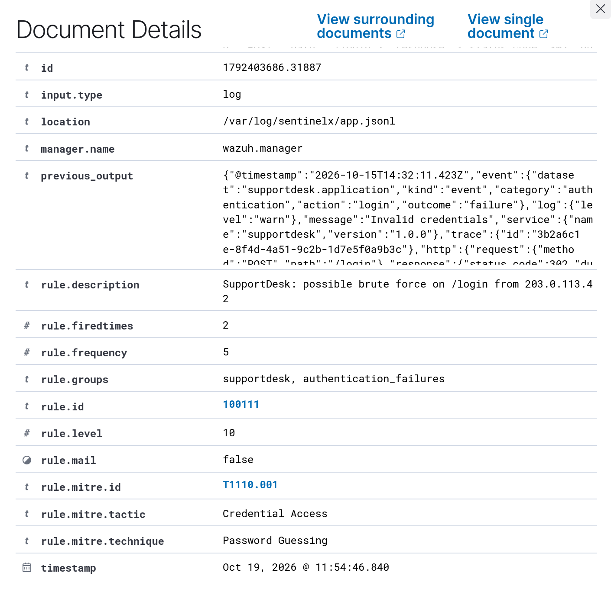

# T-005 - Brute-force correlation: burst vs spaced events

- **Date:** 19-10-2026
- **Author:** Meghan CRESCI-HUMANN
- **Wazuh version:** 4.14.9 (single-node)
- **Contract:** CONTRACT.md v0.2.0
- **Rules involved:** 100110, 100111 (`frequency="5"`, `timeframe="60"`, `same_field source.ip`)
- **MITRE ATT&CK:** T1110.001 - Password Guessing
- **Status:** ⚠️ Functional, limitation identified

## Context

In `wazuh-logtest` (T-003), rule 100111 fires on the 5th failure. During T-004, the 5 failures injected into the file produced **no** 100111 alert. This test investigates why.

## Procedure

**Case A - burst:** 5 lines written at once.

```bash
: > detection/logs/app.jsonl
for i in 1 2 3 4 5; do cat detection/samples/login_failure.jsonl >> detection/logs/app.jsonl; done
```

**Case B - spaced:** 10 lines, 3 seconds apart (30 s total, under the 60 s window).

```bash
for i in $(seq 1 10); do cat detection/samples/login_failure.jsonl >> detection/logs/app.jsonl; sleep 3; done
```

**Measurement:**

```bash
docker exec sentinelx-wazuh.manager-1 grep -c '"id":"100111"' /var/ossec/logs/alerts/alerts.json
```

## Results

| Case                                    | Failures sent  | Expected 100111 alerts   | Observed 100111 alerts  |
| --------------------------------------- | -------------- | ------------------------ | ----------------------- |
| A - burst (and variant with `sleep 1`)  | 5              | 1                        | **0**                   |
| B - 3 s apart                           | 10             | 2                        | **2** ✅                |

Additional observations:

- With `sleep 1`, the lines were still read in batches (3 events at 13:53:24, 2 at 13:53:26): the manager reads the file about every 2 seconds.
- During the first burst run, the 100110 alerts came out **out of order** (`firedtimes` 3, 5, 4, 2, 1).
- The individual 100110 alerts are all generated in both cases: only the correlation is affected.

### 100111 alert in the dashboard



It shows level 10, the source IP in the description, the MITRE mapping added automatically by Wazuh, and the `previous_output` field containing the failures that triggered the correlation.

## Analysis

When several events arrive in the same read, the `frequency` correlation does not count them correctly. The out-of-order `firedtimes` suggest that the manager processes the events of one batch in parallel. **Unconfirmed hypothesis** at this stage: it explains the results, but the internal mechanism has not been verified in the Wazuh documentation.

**Operational consequence:** a real brute force (hydra, ffuf) sends many requests per second, i.e. exactly the unfavorable case. Risks:

- delayed detection (the alert arrives later than the 5th failure);
- underestimated attack volume (fewer 100111 alerts than expected);
- in the worst case, a short attack goes undetected.

## Follow-up actions

- [ ] Replay during the real attack (step 2): measure the number of failures before the 1st 100111 alert and the detection delay.
- [ ] Test a longer burst (50, 100 failures) to see whether the correlation eventually fires and at what rate.
- [ ] Search the Wazuh documentation for parallel event processing and the related options.
- [ ] Depending on the results: adjust the threshold or add a complementary rule (for example on failure volume), and document the choice in the brute-force attack plan.