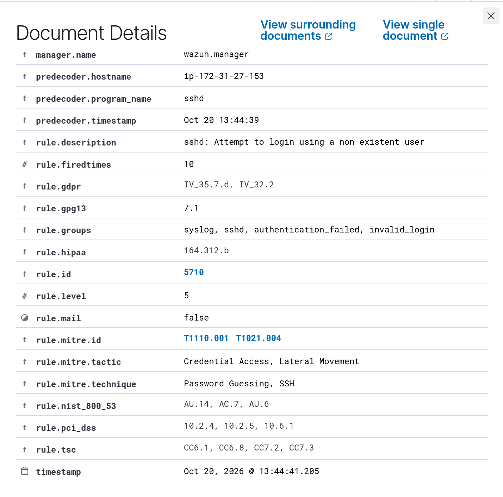
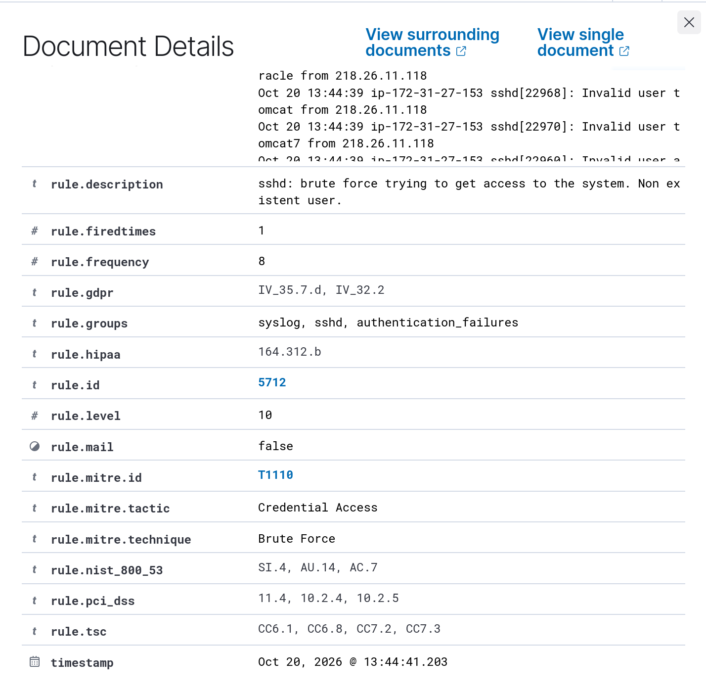

# T-012 - Wazuh native rules on training logs

- **Date:** 20-10-2026
- **Author:** Meghan CRESCI-HUMANN
- **Wazuh version:** 4.14.9 (single-node)
- **Assignment goal:** inject training logs, explore the interface, **identify native rules**
- **Status:** ✅ Native rules 5710 and 5712 identified and triggered

## Objective

The assignment asks, before writing custom rules, to inject training logs and spot the rules **already provided** by Wazuh. This test uses a real SSH authentication log dataset and documents the native rules that fire without any rule written by the team.

## Dataset

- **Source:** [secrepo.com](https://www.secrepo.com/) - `auth.log` (real Linux authentication log).
- **Volume:** 86,839 lines. File not committed (`detection/samples/training/` is in `.gitignore`).
- **Format:** standard syslog, for example:
  ```
  Nov 30 08:42:04 ip-172-31-27-153 sshd[22182]: Invalid user admin from 187.12.249.74
  ```

## Configuration

Second `<localfile>` block added in `wazuh_manager.conf`, next to the application's:

```xml
<localfile>
  <log_format>syslog</log_format>
  <location>/var/log/sentinelx/training.log</location>
</localfile>
```

Injecting a batch with the timestamp rewritten to the current time (see pitfall #1):

```bash
grep -iE "Invalid user|Failed password|authentication failure" detection/samples/training/auth.log | head -n 200 | \
  sed "s/^[A-Z][a-z]\{2\} [0-9 ][0-9] [0-9:]\{8\}/$(date '+%b %e %H:%M:%S')/" >> detection/logs/training.log
```

## Native rules identified

```bash
docker exec sentinelx-wazuh.manager-1 grep -oE '"id":"5[0-9]{3}"' /var/ossec/logs/alerts/alerts.json | sort | uniq -c | sort -rn
# 100 "id":"5710"
#   1 "id":"5712"
```

| Rule     | Level  | Description                                          | Role                                                                          | MITRE                |
| -------- | ------ | ---------------------------------------------------- | ----------------------------------------------------------------------------- | -------------------- |
| **5710** | 5      | sshd: Attempt to login using a non-existent user     | Individual event: one attempt with a non-existent user                        | T1110.001, T1021.004 |
| **5712** | 10     | sshd: brute force trying to get access to the system | **Correlation**: several failures in quick succession from the same IP (`frequency: 8`) | T1110       |

These rules automatically enrich every alert with the compliance frameworks (PCI-DSS, GDPR, HIPAA, NIST 800-53, TSC) and the MITRE ATT&CK mapping.





The 5712 alert shows, in its context, the series of attempts from a single IP (`218.26.11.118`) with different users (`oracle`, `tomcat`, `tomcat7`…): SSH user enumeration.

## Mapping to the custom rules

The native 5710 → 5712 structure is exactly the one reproduced for SupportDesk:

| Pattern                | Native rule (SSH) | Custom rule (SupportDesk web) |
| ---------------------- | ----------------- | ----------------------------- |
| Individual failure     | 5710 (level 5)    | 100110 (level 3)              |
| Correlated brute force | 5712 (level 10)   | 100111 (level 10)             |

**Justification for the custom rules:** Wazuh natively covers SSH, but **no native rule knows the SupportDesk application logs** (project-specific JSON format, web endpoints). The 100110-100161 rules fill this gap, following the same event/correlation logic as Wazuh's proven rules.

## Pitfalls encountered

1. **Timestamp without year.** The original logs are dated `Nov 30` (no year). Wazuh places them outside its real-time processing window: decoding is correct in `wazuh-logtest`, but no live alert. Solution: rewrite the timestamp to the current time with `sed` before injection.
2. **`wazuh_manager.conf` change not picked up by `docker restart`.** The file is mounted individually; a plain restart keeps the old version. The container must be recreated:
   ```bash
   docker compose -f detection/wazuh/docker-compose.wazuh.yml up -d --force-recreate wazuh.manager
   ```
3. **Empty file not analyzed.** Wazuh only opens a `<localfile>` once it contains data.

## Conclusion

Wazuh immediately detects SSH brute-force attacks through its native rules (5710, 5712), with no additional detection configuration. This validates the syslog reading chain and confirms the role of the project's custom rules: extending that coverage to the SupportDesk web application, which no native rule covers.

## Follow-up actions

- [ ] Add pitfall #2 (container recreation) to the known issues table in `setup.md`.
- [ ] Optional: inject web attack / scan logs (Apache access log) to spot the native rules of the 31xxx family (web).