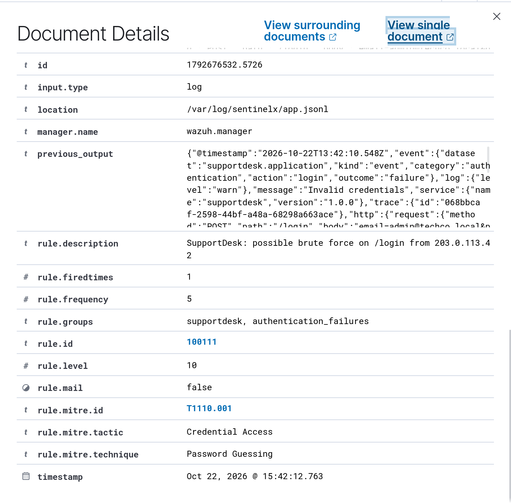

# T-013 - Dry-run: full chain on the real application

- **Date:** 22-10-2026
- **Author:** Meghan CRESCI-HUMANN
- **Wazuh version:** 4.14.9 (single-node)
- **Application:** SupportDesk V1 (container `sentinelx-supportdesk-1`)
- **Contract:** CONTRACT.md v0.3.0
- **Rules involved:** 100100, 100110, 100111
- **Status:** ✅ Dry-run successful - step 2 (real attacks) can start

## Objective

So far, all rules were validated on log **samples**. This test validates the end-to-end chain on the **actually instrumented application**: a real HTTP attack produces an application log, read by Wazuh, which generates an alert visible in the dashboard.

This is the dry-run requested at step 2. Questions it answers:

- Is a log emitted by the application received by Wazuh?
- Is the expected `event.outcome` visible in the fields?
- Does a custom rule fire on a real event?
- Does the alert appear in the dashboard, with the right severity and the right source?
- Can another team member reproduce this result?

## Prerequisites and fixes

Two application bugs had to be fixed to allow the launch:

1. **Dockerfile**: the `node:20-alpine` image forced a rebuild of `better-sqlite3` with a download that failed (`ETIMEDOUT`). Fixed by switching to `node:20-slim` (pre-built binary available).
2. **`app.js`**: the error handler called `logger.emitError(...)` while `emitError` is exported separately. Fixed by importing and calling `emitError` directly.

Both fixes were handed over to the web team.

## Dry-run architecture

```
curl (attaque) -> SupportDesk (:3000) -> écrit detection/logs/app.jsonl
                                      -> Wazuh manager lit le fichier
                                      -> règles 100110 / 100111
                                      -> alerte indexée -> dashboard
```

The log file is the shared volume `detection/logs/`, mounted read-write in the app and read-only in `wazuh.manager` (D-008).

## Procedure

**1. Start the application** (Wazuh is already running):

```bash
cd supportdesk
docker compose up -d --build
cd ..
```

→
→
→
→
→
→
→
→
→
→
**2. Verify that the app responds and logs**:

```bash
curl -s -o /dev/null -w "HTTP %{http_code}\n" http://localhost:3000/login
tail -n 1 detection/logs/app.jsonl
```

The request returns HTTP 200 and produces a log line compliant with the contract.

**3. Attack: 5 real login failures**, with an IP simulated via `X-Forwarded-For` (contract §4.2):

```bash
for i in 1 2 3 4 5; do
  curl -s -o /dev/null -X POST http://localhost:3000/login \
    -d 'email=admin@techco.local&password=wrongpass' \
    -H 'X-Forwarded-For: 203.0.113.42'
  sleep 2
done
sleep 20
```

**4. Check the alerts**:

```bash
docker exec sentinelx-wazuh.manager-1 grep -c '"id":"100110"' /var/ossec/logs/alerts/alerts.json
docker exec sentinelx-wazuh.manager-1 grep -c '"id":"100111"' /var/ossec/logs/alerts/alerts.json
```

## Results

Real log produced by the application (login failure):

```json
{
  "event": {
    "category": "authentication",
    "action": "login",
    "outcome": "failure"
  },
  "message": "Invalid credentials",
  "http": {
    "request": {
      "method": "POST",
      "path": "/login",
      "body": "email=admin@techco.local&password=***"
    },
    "response": { "status_code": 302 }
  },
  "source": { "ip": "203.0.113.42" },
  "user": { "name": "admin@techco.local" }
}
```

| Check                                   | Expected                   | Observed                             |
| --------------------------------------- | -------------------------- | ------------------------------------ |
| Application responds                    | HTTP 200                   | ✅                                   |
| Login failure reported                  | `event.outcome = failure`  | ✅ (login route does call `stage()`) |
| Password masked                         | `password=***`             | ✅                                   |
| Simulated client IP taken into account  | `source.ip = 203.0.113.42` | ✅ (via `X-Forwarded-For`)           |
| 100110 alerts (individual failure)      | ≥ 1                        | ✅ 4                                 |
| 100111 alert (brute force)              | ≥ 1                        | ✅ 1                                 |
| Alert visible in the dashboard          | yes, level 10, correct IP  | ✅                                   |



## Notable points

- **`source.ip` without `X-Forwarded-For` returns the Docker bridge IP** (`::ffff:172.18.0.1`), exactly the case anticipated in contract §4.2. The `X-Forwarded-For` header makes it possible to simulate distinct attackers, and is also the documented evasion vector (IP rotation).
- The format produced by the logger is **identical to the samples** used to develop the rules: no adaptation was needed on the detection side. Validating the format _before_ implementation (T-006) paid off.

## Conclusion

The complete chain works on the real application: HTTP attack -> application log -> Wazuh -> rule -> indexed and visible alert. The dry-run is successful, step 2 (executing the real attack plans) can start.

## Reproducibility

Another team member reproduces this test by: starting Wazuh then the app (`docker compose up -d --build`), then running the attack loop above. The commands are self-contained and depend on no prior state.

## Follow-up actions

- [ ] Execute attack plans AP-01/02/03 with the real tools (hydra, sqlmap, ffuf) and fill in the runbooks.
- [ ] Verify the burst behavior (T-005) with a real fast hydra.
- [ ] Integrate the Dockerfile + `app.js` fixes into the team branch.